# Application architecture

Hugo serves the view layer. ChatbotProvider directly renders AssistantConfiguration and the selected Local or Online component in the same tree. The service slices share retrieval and configuration coordination, while each tab keeps its own persisted conversation. Generation and model discovery use the same configured API base URL. See [RagService](rag-service.md), [ConfigurationService](configuration-service.md) and [ProgressService](progress-service.md) for their contracts and complete flows.

Implementation: `94d623f1c02be5e7b75998c841ce7276c59e7d36`. Focused checks, typecheck, lint, production build and primary runtime journeys pass. Source-matched real Local cache verification passes; both independent reviews pass at `c8121960ce811989aa99a5b2a968dd2171badf2e`, followed by 171/171 full-suite tests. Comparison base: `df7fd5597ec6613af55ddba4506ca61ce6109e7c`. Live credentialed OpenAI access remains unverified.

Green borders mark added components; yellow borders mark modified source; default borders mark unchanged or pure-moved code. Solid arrows show runtime calls/data and dotted arrows show type relationships. Composition remains disconnected. See [maintenance and style](README.md).

```mermaid
flowchart TB
  subgraph Build["Static build"]
    Hugo["Hugo"]
    Layout["layouts/home.html"]
    ContentInput["content/ / config/"]
    Public["public/"]
  end
  subgraph Views["Views layer"]
    ChatUI["ChatContainer"]
    SettingsUI["AssistantConfiguration"]
    ProgressUI["ProgressContainer"]
  end
  subgraph Services["Services layer"]
    Rag["RagService"]
    Settings["ConfigurationService"]
    Progress["ProgressService"]
  end
  subgraph Shared["Shared contracts"]
    ChatService["ChatbotServiceContract"]
    ConfigService["ConfigurationServiceContract"]
    ProgressService["ProgressServiceContract"]
    Session["ChatSessionContract"]
    HistoryContract["ChatHistoryRepositoryContract"]
    Port["StandardCommunicationContract"]
    Runtime["RuntimeCoordinatorContract / RuntimeLifecycleContract"]
    AdapterContract["RuntimeConfigurationAdapterContract"]
    ModelOption["ModelOption"]
    LocalDTO["ModelDescriptor"]
    OnlineDTO["OnlineModel"]
  end
  subgraph Data["Data layer — browser tab"]
    Chat["Chat"]
    Online["OnlineChatClient"]
    ApiBase["ApiBase"]
    DB["DB"]
    Standard["StandardCommunication / StandardCommunicationBaseAbstract"]
    Coordinator["RuntimeCoordinator"]
    CoordinatorBase["RuntimeCoordinatorAbstract"]
    Connection["RuntimeCoordinatorConnection"]
    Transport["SharedWorkerManager"]
    WorkerBase["WorkerBase — abstract"]
    Content["ContentRepository / ChatMessageModel"]
    History["ChatHistoryRepository"]
    IDB["IndexDBBase"]
    Preferences["ConfigurationRepository"]
    Metadata["ModelMetadataRepository"]
    Identity["ConversationIdentity"]
    StorageBase["WebStorageBase — abstract"]
    Catalog["OnlineModelRepository"]
    Adapter["RuntimeConfigurationAdapter"]
  end
  subgraph Workers["SharedWorkers — generation starts only for Local"]
    Hub["RuntimeCoordinatorStateMachine<br/>runtime-coordinator.shared-worker.ts"]
    Retrieval["SharedModelRuntime / createRetrievalDriver<br/>vectordb.shared-worker.ts"]
    Index["VectorDBHNSWData"]
    subgraph GenerationWorker["llm.shared-worker.ts"]
      Gen["SharedModelRuntime"]
      Handler["createLlmMessageHandler"]
      Local["LocalLLMData"]
    end
  end
  subgraph Server["Server — Express and provider integration"]
    Models["GET /api/models"]
    Generate["generate — POST /api/generate"]
    Provider["OpenAIProvider"]
    ProviderBase["GenerationProviderAbstract"]
    SDK["OpenAI.responses.create — openai"]
  end
  subgraph Resources["Storage, content and external resources"]
    Storage["localStorage — settings"]
    TabStorage["sessionStorage — current conversation ID"]
    Cache["CacheStorage — models / metadata"]
    IndexedDB["indexedDB — retrieval index / chat history"]
    Files["chunks.json / contents.bin / vector-metadata.json"]
    HF["huggingface.co — metadata / model files"]
    OpenAI["gpt-6-luna — low reasoning effort"]
  end
  subgraph Composition["Composition — names only"]
    Root["ChatbotProvider / buildChatbotDeps"]
    Offline["ChatbotOfflineProvider / buildChatbotOfflineDeps"]
    OnlineProvider["ChatbotOnlineProvider / buildChatbotOnlineDeps"]
    BaseProvider["ChatbotModeProviderAbstract"]
    ServiceFactory["buildRagService"]
    ProgressProvider["ProgressProvider / progressFactory"]
    RuntimeFactory["getRuntimeCoordinator"]
    Context["chatbotCompositionContext"]
    ExistingContext["configurationContext / chatbotContext"]
    Entry["server/main.composition.ts / createApp"]
  end
  Hugo --> Public
  Layout --> Hugo
  ContentInput --> Hugo
  Public --> ChatUI
  Public --> SettingsUI
  Public --> ProgressUI
  ChatUI <-->|"actions and response state"| Rag
  SettingsUI <-->|"edits and settings state"| Settings
  ProgressUI <-->|"loading state"| Progress
  ChatUI -.->|"uses"| ChatService
  Rag -.->|"implements"| ChatService
  Settings -.->|"implements"| ConfigService
  Progress -.->|"implements"| ProgressService
  Rag -.->|"uses"| Session
  Session -.->|"history dependency"| HistoryContract
  Session -.->|"runtime dependency"| Runtime
  Rag -.->|"uses"| Port
  Rag <-->|"Local generation"| Chat
  Rag <-->|"Online generation"| Online
  Rag <-->|"retrieval"| DB
  Rag <-->|"prompt and passages"| Content
  Rag <-->|"load/save/reset"| History
  History -.->|"implements"| HistoryContract
  History -->|"versioned store"| IDB
  History <-->|"transaction commit"| IndexedDB
  IDB --> IndexedDB
  Chat -.->|"extends"| Standard
  DB -.->|"extends"| Standard
  Standard -.->|"implements"| Port
  Online -.->|"implements"| Port
  Online -.->|"extends"| ApiBase
  Content --> Files
  Rag <-->|"response lease / recovery"| Coordinator
  Rag -->|"successful explicit reconnect retries availability"| Settings
  Settings <-->|"saved choices"| Preferences
  Settings <-->|"Local metadata"| Metadata
  Settings <-->|"allowed Online choices"| Catalog
  Settings <-->|"configure and observe"| Adapter
  Adapter -.->|"implements"| AdapterContract
  Adapter -->|"availability"| Rag
  Adapter <-->|"settings; mount permission after drain"| Coordinator
  Preferences <-->|"settings"| Storage
  Metadata <-->|"metadata cache"| Cache
  Metadata <-->|"pinned metadata"| HF
  Metadata -.->|"extends"| ApiBase
  Metadata -.->|"uses"| LocalDTO
  Catalog -.->|"uses"| OnlineDTO
  LocalDTO -.->|"extends"| ModelOption
  OnlineDTO -.->|"extends"| ModelOption
  Preferences -.->|"extends"| StorageBase
  Identity -.->|"extends"| StorageBase
  Identity <-->|"reload-only conversation ID"| TabStorage
  Catalog <-->|"allowed model catalog"| Models
  Catalog -.->|"extends"| ApiBase
  Progress <-->|"model progress"| Coordinator
  Chat <-->|"Local messages"| Coordinator
  DB <-->|"retrieval messages"| Coordinator
  Coordinator -.->|"extends"| CoordinatorBase
  CoordinatorBase -.->|"implements"| Runtime
  Coordinator <-->|"transport"| Connection
  Connection -.->|"extends"| Transport
  Transport -.->|"extends"| WorkerBase
  Connection <-->|"MessagePort"| Hub
  Hub <-->|"retrieval"| Retrieval
  Retrieval <-->|"embed and search"| Index
  Index --> Files
  Index --> HF
  Index --> Cache
  Index --> IndexedDB
  Hub <-->|"Local FIFO generation"| Gen
  Gen <-->|"handle and publish"| Handler
  Handler <-->|"inference"| Local
  Local --> HF
  Local --> Cache
  Online <-->|"HTTP stream / abort"| Generate
  Generate -.->|"provider contract"| ProviderBase
  Generate <-->|"injected provider"| Provider
  Provider -.->|"extends"| ProviderBase
  Provider <-->|"stream / AbortSignal"| SDK
  SDK <-->|"generation"| OpenAI
  classDef added stroke:#2da44e,stroke-width:3px;
  class Online,Session,HistoryContract,History,Catalog,Models,Generate,Provider,ProviderBase,SDK,OpenAI,Root,OnlineProvider,BaseProvider,ServiceFactory,Context,Entry,Identity,StorageBase,TabStorage,ModelOption,OnlineDTO added;
  classDef modified stroke:#bf8700,stroke-width:3px;
  class Layout,ChatUI,SettingsUI,Rag,Settings,ChatService,Preferences,Metadata,LocalDTO,ApiBase,IDB,Adapter,CoordinatorBase,Connection,Hub,Offline modified;
  style GenerationWorker stroke:#bf8700,stroke-width:3px
```

