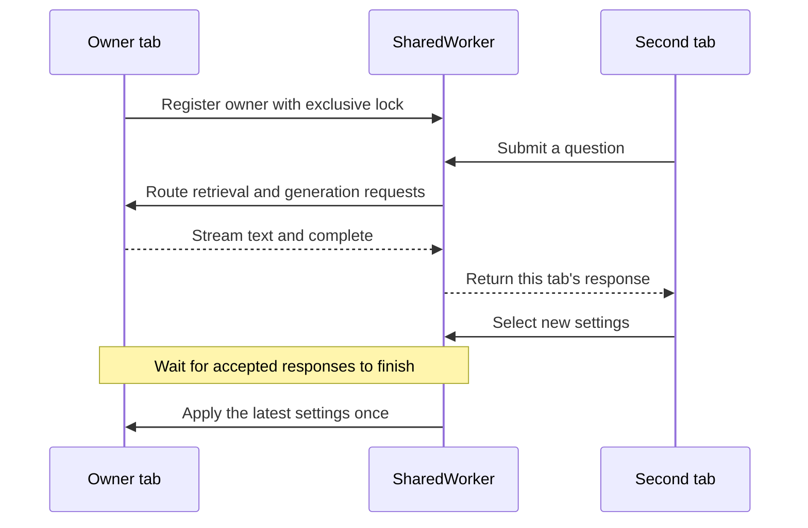

# Assistant settings and the shared bot

Only one tab hosts the live bot. Other tabs send requests through the existing SharedWorker. Each tab keeps its own conversation; opening another tab does not load another model.

Composition injects browser storage and storage events into the configuration repository. The repository owns keys and serialization. The configuration service uses typed repository methods; the settings component only renders service state and forwards edits.

Selected settings are the latest valid choices. Active settings describe the runtime in use. Edits persist immediately, but an active response keeps its starting settings. Generation-only edits do not reload model weights. Auto passes directly to both pipelines; CPU maps to WASM.

Online is an unavailable placeholder. It preserves local preferences and conversation history but disables Send. A failed configuration shows its requested values and diagnostic; recovery requires an explicit action.

If the owner closes, a remaining tab can acquire the exclusive lock and initialize one replacement bot. Interrupted questions are not replayed automatically. The remaining tab keeps its conversation.

## Source

- [Shared coordinator](../../assets/layers/data/shared-bot-coordinator.data.ts)
- [Runtime adapter](../../assets/layers/data/shared-configuration-runtime.data.ts)
- [Configuration service](../../assets/layers/services/configuration.service.ts)
- [Configuration repository](../../assets/layers/data/configuration-repository.data.ts)
- [Settings component](../../assets/layers/views/configuration.component.ts)
