# ConfigurationService

[Source](../../assets/layers/services/configuration.service.ts). The settings slice restores preferences, discovers Local/Online model choices, and changes the shared runtime after accepted responses drain. Its repositories keep preferences, local metadata caching and API catalog access separate. OnlineModelRepository and OnlineChatClient receive the same API base URL from Hugo configuration and reuse ApiBase for URL resolution.

Implementation: `edf9cc20dfec589ac8584efd93e55c0cfd1e26ed` (signed channel-recovery checkpoint). Failed channel hosting is retried when the same coordinator attachment recovers. Settings, real Local and controlled Online journeys pass. Native audible speech remains unverified under the approved alternative. Repeat reviews and the final suite are pending. Comparison base: `44e79ef4695dc7e24defb50981dd16ec21cf1179`. Green borders mark additions; yellow borders mark modified source; default borders mark unchanged components. Solid arrows show runtime calls/data; dotted arrows show type relationships. Composition remains disconnected. See [the architecture skill](../../.agents/skills/architecture-mermaid/SKILL.md).

```mermaid
flowchart TB
  subgraph Views["Views layer"]
    UI["AssistantConfiguration"]
  end
  subgraph Services["Services layer"]
    Settings["ConfigurationService"]
    Rag["RagService"]
  end
  subgraph Shared["Shared layer — contracts and models"]
    ServiceContract["ConfigurationServiceContract"]
    SettingsContract["ConfigurationRepositoryContract"]
    MetadataContract["ModelMetadataRepositoryContract"]
    OnlineContract["OnlineModelRepositoryContract"]
    OnlineDTO["OnlineModel"]
    LocalDTO["ModelDescriptor"]
    ModelOption["ModelOption"]
    AdapterContract["RuntimeConfigurationAdapterContract"]
    SettingsDTO["AssistantSettings"]
    ApiContract["ApiContract"]
  end
  subgraph Data["Data layer"]
    Saved["ConfigurationRepository"]
    StorageBase["WebStorageBase — abstract"]
    Metadata["ModelMetadataRepository"]
    Catalogue["OnlineModelRepository"]
    ApiBase["ApiBase"]
    Adapter["RuntimeConfigurationAdapter"]
    Coordinator["RuntimeCoordinator"]
    CoordinatorBase["RuntimeCoordinatorAbstract"]
    Connection["RuntimeCoordinatorConnection"]
    Transport["SharedWorkerManager"]
    WorkerBase["WorkerBase — abstract"]
    DB["DB"]
  end
  subgraph Workers["Data layer — SharedWorkers"]
    Hub["RuntimeCoordinatorStateMachine<br/>runtime-coordinator.shared-worker.ts"]
    subgraph GenerationWorker["llm.shared-worker.ts"]
      Llm["SharedModelRuntime"]
    end
    Vdb["SharedModelRuntime<br/>vectordb.shared-worker.ts"]
  end
  subgraph Server["Server — Express API"]
    API["GET /api/models<br/>server/app.factory.ts"]
  end
  subgraph Resources["Storage and external metadata"]
    Storage["localStorage"]
    HF["huggingface.co/api/models<br/>pinned revision"]
    Cache["CacheStorage<br/>assistant-model-metadata-v1"]
  end
  subgraph Composition["Composition — entry-point names only"]
    BrowserProvider["ChatbotProvider"]
    BrowserFactory["buildChatbotDeps"]
    LocalComposition["ChatbotOfflineProvider / buildChatbotOfflineDeps"]
    OnlineComposition["ChatbotOnlineProvider / buildChatbotOnlineDeps"]
    ModeBase["ChatbotModeProviderAbstract"]
    ServerComposition["server/main.composition.ts"]
    AppFactory["createApp"]
  end

  UI <-->|"edits and state subscription"| Settings
  UI -.->|"uses"| ServiceContract
  Settings -.->|"implements"| ServiceContract
  Settings -.->|"uses"| SettingsContract
  Settings -.->|"uses"| MetadataContract
  Settings -.->|"uses"| OnlineContract
  Settings -.->|"uses"| AdapterContract
  Settings <-->|"load, save and observe preferences"| Saved
  Settings <-->|"Local model options"| Metadata
  Settings <-->|"Online model options"| Catalogue
  Settings <-->|"selected and active settings"| Adapter
  Saved -.->|"implements"| SettingsContract
  Metadata -.->|"implements"| MetadataContract
  Metadata -.->|"extends"| ApiBase
  Metadata -.->|"uses"| LocalDTO
  LocalDTO -.->|"extends"| ModelOption
  OnlineDTO -.->|"extends"| ModelOption
  Saved -.->|"extends"| StorageBase
  Catalogue -.->|"implements"| OnlineContract
  Catalogue -.->|"extends"| ApiBase
  ApiBase -.->|"implements"| ApiContract
  Adapter -.->|"implements"| AdapterContract
  Saved <-->|"persist and observe"| Storage
  Metadata <-->|"fetch matching revision"| HF
  Metadata <-->|"cache validated metadata"| Cache
  Catalogue <-->|"fetch allowed choices"| API
  Adapter <-->|"configure and observe"| Coordinator
  Adapter -->|"setAvailable"| Rag
  Adapter -->|"host shared retrieval once"| DB
  Coordinator <-->|"transport"| Connection
  Connection -.->|"extends"| Transport
  Transport -.->|"extends"| WorkerBase
  Connection <-->|"configuration and runtime state"| Hub
  Hub <-->|"configure Local generation"| Llm
  Hub <-->|"configure retrieval"| Vdb
  Coordinator -.->|"extends"| CoordinatorBase
  Catalogue -.->|"uses"| OnlineDTO
  API -.->|"uses"| OnlineDTO

  classDef added stroke:#2da44e,stroke-width:3px;

  Settings -.->|"uses"| SettingsDTO
  Adapter -.->|"uses"| SettingsDTO
  classDef modified stroke:#bf8700,stroke-width:3px;
  class CoordinatorBase modified;
  class Rag modified;
```

