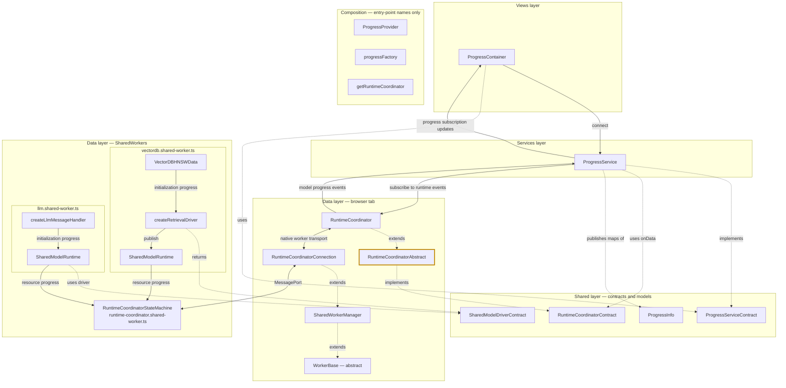

# ProgressService

[Source](../../assets/layers/services/progress.service.ts). The progress slice forwards model-initialization events from the coordinator to ProgressContainer. Online answer-token deltas use RagService, rather than this progress subscription.

Implementation: `edf9cc20dfec589ac8584efd93e55c0cfd1e26ed` (signed channel-recovery checkpoint). Failed channel hosting is retried when the same coordinator attachment recovers. Settings, real Local and controlled Online journeys pass. Native audible speech remains unverified under the approved alternative. Both independent reviews and final checks pass; see the [ticket](../../tasks/20261108-123438/TASK.md) for evidence. Comparison base: `44e79ef4695dc7e24defb50981dd16ec21cf1179`. Green borders mark additions; yellow borders mark modified source; default borders mark unchanged components. Solid arrows show runtime calls/data; dotted arrows show type relationships. Composition remains disconnected. See [the architecture skill](../../.agents/skills/architecture-mermaid/SKILL.md).

