# RagService

[Source](../../assets/layers/services/chatbot.service.ts). The host mounts one injected mode tree after accepted work drains. Both trees reuse ChatContainer, RagService, the tab's retrieval DB and its persisted conversation. Only generation changes transport.

Implementation: `e6b713fef5238f13a2aef46d0d3c53b0319d1bb7`. Primary Online, settings and real Local CPU/cache journeys are verified; the supplemental forced-close limitation is recorded in the ticket. Comparison base: `df7fd5597ec6613af55ddba4506ca61ce6109e7c`. Live credentialed OpenAI access is unverified.

Green borders mark added components; yellow borders mark modified source; default borders mark unchanged or pure-moved code. Solid arrows show runtime calls/data and dotted arrows show type relationships. Composition remains disconnected. See [maintenance and style](README.md).

```mermaid
flowchart TB
  subgraph Views["Views layer — browser tab"]
    Host["ChatbotHost"]
    UI["ChatContainer"]
  end
  subgraph Services["Services layer — browser tab"]
    Settings["ConfigurationService"]
    Rag["RagService"]
  end
  subgraph Contracts["Shared layer — contracts"]
    ServiceContract["ChatbotServiceContract"]
    SettingsContract["ConfigurationServiceContract"]
    Port["StandardCommunicationContract<br/>StandardCommunicationBaseContract"]
    Session["ChatSessionContract"]
    HistoryContract["ChatHistoryRepositoryContract"]
    Lifecycle["RuntimeLifecycleContract"]
    RuntimeContract["RuntimeCoordinatorContract"]
    ContentContract["ContentRepositoryContract"]
    PromptContract["ChatMessageModelContract"]
    DriverContract["SharedModelDriverContract"]
    ApiContract["ApiContract"]
    StoreContract["StoreContract"]
    MessagingContract["MessagingBaseContract"]
  end
  subgraph Data["Data layer — browser tab"]
    Chat["Chat"]
    Online["OnlineChatClient"]
    ApiBase["ApiBase"]
    DB["DB"]
    Standard["StandardCommunication<br/>abstract"]
    StandardBase["StandardCommunicationBaseAbstract"]
    History["ChatHistoryRepository"]
    IDB["IndexDBBase"]
    Content["ContentRepository"]
    Prompt["ChatMessageModel"]
    Coordinator["RuntimeCoordinator"]
    CoordinatorBase["RuntimeCoordinatorAbstract"]
    Connection["RuntimeCoordinatorConnection"]
    Transport["SharedWorkerManager"]
    WorkerBase["WorkerBase — abstract"]
  end
  subgraph Workers["Data layer — SharedWorkers"]
    Hub["RuntimeCoordinatorStateMachine<br/>runtime-coordinator.shared-worker.ts"]
    Retrieval["SharedModelRuntime<br/>createRetrievalDriver<br/>vectordb.shared-worker.ts"]
    Index["VectorDBHNSWData"]
    subgraph GenerationWorker["llm.shared-worker.ts"]
      Generation["SharedModelRuntime"]
      GenerationFactory["createLlmDriver"]
      Handler["createLlmMessageHandler"]
      Local["LocalLLMData"]
    end
  end
  subgraph Server["Server — Express API and provider integration"]
    API["generate — POST /api/generate"]
    DTO["GenerationRequest"]
    Provider["OpenAIProvider"]
    ProviderBase["GenerationProviderAbstract"]
    Instructions["assistantInstructions"]
    SDK["OpenAI.responses.create — openai"]
  end
  subgraph Resources["Storage, content and external resources"]
    IndexedDB["indexedDB — assistant-chat-history / conversations"]
    Chunks["/content-data/chunks.json"]
    RetrievalAssets["Xenova/all-MiniLM-L6-v2<br/>contents.bin / vector-metadata.json"]
    LocalWeights["Xenova/Qwen1.5-0.5B-Chat"]
    Cache["CacheStorage — model files"]
    OpenAI["gpt-6-luna — low reasoning effort"]
  end
  subgraph Composition["Composition — names only"]
    Root["ChatbotProvider / buildChatbotDeps"]
    OfflineProvider["ChatbotOfflineProvider"]
    OnlineProvider["ChatbotOnlineProvider"]
    ModeBase["ChatbotModeProviderAbstract"]
    LocalFactory["buildChatbotOfflineDeps"]
    Factories["buildChatbotOnlineDeps / buildRagService"]
    Context["chatbotCompositionContext"]
    ExistingContext["configurationContext / chatbotContext"]
    Identity["getConversationId — sessionStorage reload identity"]
    ServerComposition["server/main.composition.ts / createApp"]
  end
  Host <-->|"mounted settings"| Settings
  Host -->|"one mode tree reuses"| UI
  Host -.->|"uses"| SettingsContract
  Settings -.->|"implements"| SettingsContract
  UI <-->|"Send, Cancel, Reset, Retry; state and text"| Rag
  UI -.->|"uses"| ServiceContract
  Rag -.->|"implements"| ServiceContract
  Rag -.->|"uses"| Port
  Rag -.->|"uses"| Session
  Session -.->|"history dependency"| HistoryContract
  Session -.->|"optional runtime dependency"| Lifecycle
  RuntimeContract -.->|"extends"| Lifecycle
  Rag <-->|"Local generation"| Chat
  Rag <-->|"Online generation"| Online
  Rag <-->|"retrieve passages; cancel"| DB
  Rag <-->|"load, ordered save, clear"| History
  History -.->|"implements"| HistoryContract
  History -->|"versioned open"| IDB
  History <-->|"transaction commit"| IndexedDB
  IDB -->|"open store"| IndexedDB
  IDB -.->|"implements"| StoreContract
  Rag <-->|"begin; finish after writes drain; reconnect"| Coordinator
  Rag -->|"successful explicit reconnect retries availability"| Settings
  Rag <-->|"load passages"| Content
  Rag -.->|"uses"| ContentContract
  Content -.->|"implements"| ContentContract
  Content -->|"read"| Chunks
  Content -.->|"extends"| ApiBase
  Rag <-->|"prepare context and completed history"| Prompt
  Rag -.->|"uses"| PromptContract
  Prompt -.->|"implements"| PromptContract
  Chat -.->|"extends"| Standard
  DB -.->|"extends"| Standard
  Standard -.->|"extends"| StandardBase
  StandardBase -.->|"implements"| Port
  Online -.->|"implements"| Port
  Online -.->|"extends"| ApiBase
  ApiBase -.->|"implements"| ApiContract
  Chat <-->|"Local generation messages"| Coordinator
  DB <-->|"retrieval messages"| Coordinator
  Coordinator -.->|"extends"| CoordinatorBase
  CoordinatorBase -.->|"implements"| RuntimeContract
  Coordinator <-->|"native transport"| Connection
  Connection -.->|"extends"| Transport
  Transport -.->|"extends"| WorkerBase
  WorkerBase -.->|"implements"| MessagingContract
  Connection <-->|"MessagePort"| Hub
  Hub <-->|"retrieval"| Retrieval
  Retrieval -.->|"driver satisfies"| DriverContract
  Retrieval <-->|"embed and search"| Index
  Index -->|"load"| RetrievalAssets
  Hub <-->|"Local FIFO generation and confirmed stop"| Generation
  Generation -->|"create driver"| GenerationFactory
  GenerationFactory -->|"return handler"| Handler
  GenerationFactory -.->|"returns"| DriverContract
  Generation <-->|"handle and publish"| Handler
  Handler <-->|"generate"| Local
  Local -->|"load"| LocalWeights
  Local -->|"Transformers.js cache"| Cache
  Index -->|"Transformers.js cache"| Cache
  Online <-->|"POST stream; AbortSignal"| API
  API -.->|"uses"| DTO
  API -.->|"provider contract"| ProviderBase
  API <-->|"injected provider"| Provider
  Provider -.->|"extends"| ProviderBase
  Provider -.->|"uses"| DTO
  Provider -->|"trusted instructions"| Instructions
  Provider <-->|"stream; AbortSignal"| SDK
  SDK <-->|"request and streamed response"| OpenAI
  classDef added stroke:#2da44e,stroke-width:3px;
  class Host,Online,Session,HistoryContract,History,IndexedDB,API,DTO,Provider,ProviderBase,Instructions,SDK,OpenAI,Root,OnlineProvider,ModeBase,Factories,Context,Identity,ServerComposition added;
  classDef modified stroke:#bf8700,stroke-width:3px;
  class UI,Settings,Rag,ServiceContract,ApiBase,IDB,CoordinatorBase,Connection,Hub,OfflineProvider,LocalFactory modified;
  style GenerationWorker stroke:#bf8700,stroke-width:3px
```

