# RagService

[Source](../../assets/layers/services/rag.service.ts). ChatbotProvider renders AssistantConfiguration and one mode component directly in its tree after accepted work drains. Both modes reuse ChatContainer, RagService, the tab's retrieval DB and its persisted conversation. Only generation changes transport.

Implementation: uncommitted PR review fixes based on `5d05a2530354812381bff4855ab3e93d037ae189`. Focused checks, typecheck and production build pass; current runtime verification and both independent reviews remain in progress. Comparison base: `df7fd5597ec6613af55ddba4506ca61ce6109e7c`. Live credentialed OpenAI access remains unverified.

Green borders mark added components; yellow borders mark modified source; default borders mark unchanged or pure-moved code. Solid arrows show runtime calls/data and dotted arrows show type relationships. Composition remains disconnected. See [maintenance and style](README.md).

```mermaid
flowchart TB
  subgraph Views["Views layer — browser tab"]
    UI["ChatContainer"]
  end
  subgraph Services["Services layer — browser tab"]
    Settings["ConfigurationService"]
    Rag["RagService"]
  end
  subgraph Contracts["Shared layer — contracts"]
    ServiceContract["ChatbotServiceContract"]
    SettingsContract["ConfigurationServiceContract"]
    Port["StandardCommunicationContract<br/>StandardCommunicationBaseContract"]
    Session["ChatSessionContract"]
    HistoryContract["ChatHistoryRepositoryContract"]
    Lifecycle["RuntimeLifecycleContract"]
    RuntimeContract["RuntimeCoordinatorContract"]
    ContentContract["ContentRepositoryContract"]
    PromptContract["ChatMessageModelContract"]
    DriverContract["SharedModelDriverContract"]
    ApiContract["ApiContract"]
    StoreContract["StoreContract"]
    MessagingContract["MessagingBaseContract"]
  end
  subgraph Data["Data layer — browser tab"]
    Chat["Chat"]
    Online["OnlineChatClient"]
    ApiBase["ApiBase"]
    DB["DB"]
    Standard["StandardCommunication<br/>abstract"]
    StandardBase["StandardCommunicationBaseAbstract"]
    History["ChatHistoryRepository"]
    Identity["ConversationIdentity"]
    StorageBase["WebStorageBase — abstract"]
    IDB["IndexDBBase"]
    Content["ContentRepository"]
    Prompt["ChatMessageModel"]
    Coordinator["RuntimeCoordinator"]
    CoordinatorBase["RuntimeCoordinatorAbstract"]
    Connection["RuntimeCoordinatorConnection"]
    Transport["SharedWorkerManager"]
    WorkerBase["WorkerBase — abstract"]
  end
  subgraph Workers["Data layer — SharedWorkers"]
    Hub["RuntimeCoordinatorStateMachine<br/>runtime-coordinator.shared-worker.ts"]
    Retrieval["SharedModelRuntime<br/>createRetrievalDriver<br/>vectordb.shared-worker.ts"]
    Index["VectorDBHNSWData"]
    subgraph GenerationWorker["llm.shared-worker.ts"]
      Generation["SharedModelRuntime"]
      GenerationFactory["createLlmDriver"]
      Handler["createLlmMessageHandler"]
      Local["LocalLLMData"]
    end
  end
  subgraph Server["Server — Express API and provider integration"]
    API["generate — POST /api/generate"]
    DTO["GenerationRequest"]
    Provider["OpenAIProvider"]
    ProviderBase["GenerationProviderAbstract"]
    Instructions["assistantInstructions"]
    SDK["OpenAI.responses.create — openai"]
  end
  subgraph Resources["Storage, content and external resources"]
    IndexedDB["indexedDB — assistant-chat-history / conversations"]
    TabStorage["sessionStorage — current conversation ID"]
    Chunks["/content-data/chunks.json"]
    RetrievalAssets["Xenova/all-MiniLM-L6-v2<br/>contents.bin / vector-metadata.json"]
    LocalWeights["Xenova/Qwen1.5-0.5B-Chat"]
    Cache["CacheStorage — model files"]
    OpenAI["gpt-6-luna — low reasoning effort"]
  end
  subgraph Composition["Composition — names only"]
    Root["ChatbotProvider / buildChatbotDeps"]
    OfflineProvider["ChatbotOfflineProvider"]
    OnlineProvider["ChatbotOnlineProvider"]
    ModeBase["ChatbotModeProviderAbstract"]
    LocalFactory["buildChatbotOfflineDeps"]
    Factories["buildChatbotOnlineDeps / buildRagService"]
    Context["chatbotCompositionContext"]
    ExistingContext["configurationContext / chatbotContext"]
    ServerComposition["server/main.composition.ts / createApp"]
  end
  Settings -.->|"implements"| SettingsContract
  UI <-->|"Send, Cancel, Reset, Retry; state and text"| Rag
  UI -.->|"uses"| ServiceContract
  Rag -.->|"implements"| ServiceContract
  Rag -.->|"uses"| Port
  Rag -.->|"uses"| Session
  Session -.->|"history dependency"| HistoryContract
  Session -.->|"optional runtime dependency"| Lifecycle
  RuntimeContract -.->|"extends"| Lifecycle
  Rag <-->|"Local generation"| Chat
  Rag <-->|"Online generation"| Online
  Rag <-->|"retrieve passages; cancel"| DB
  Rag <-->|"load, ordered save, clear"| History
  Identity -.->|"extends"| StorageBase
  Identity <-->|"reload-only conversation ID"| TabStorage
  History -.->|"implements"| HistoryContract
  History -->|"versioned open"| IDB
  History <-->|"transaction commit"| IndexedDB
  IDB -->|"open store"| IndexedDB
  IDB -.->|"implements"| StoreContract
  Rag <-->|"begin; finish after writes drain; reconnect"| Coordinator
  Rag -->|"successful explicit reconnect retries availability"| Settings
  Rag <-->|"load passages"| Content
  Rag -.->|"uses"| ContentContract
  Content -.->|"implements"| ContentContract
  Content -->|"read"| Chunks
  Content -.->|"extends"| ApiBase
  Rag <-->|"prepare context and completed history"| Prompt
  Rag -.->|"uses"| PromptContract
  Prompt -.->|"implements"| PromptContract
  Chat -.->|"extends"| Standard
  DB -.->|"extends"| Standard
  Standard -.->|"extends"| StandardBase
  StandardBase -.->|"implements"| Port
  Online -.->|"implements"| Port
  Online -.->|"extends"| ApiBase
  ApiBase -.->|"implements"| ApiContract
  Chat <-->|"Local generation messages"| Coordinator
  DB <-->|"retrieval messages"| Coordinator
  Coordinator -.->|"extends"| CoordinatorBase
  CoordinatorBase -.->|"implements"| RuntimeContract
  Coordinator <-->|"native transport"| Connection
  Connection -.->|"extends"| Transport
  Transport -.->|"extends"| WorkerBase
  WorkerBase -.->|"implements"| MessagingContract
  Connection <-->|"MessagePort"| Hub
  Hub <-->|"retrieval"| Retrieval
  Retrieval -.->|"driver satisfies"| DriverContract
  Retrieval <-->|"embed and search"| Index
  Index -->|"load"| RetrievalAssets
  Hub <-->|"Local FIFO generation and confirmed stop"| Generation
  Generation -->|"create driver"| GenerationFactory
  GenerationFactory -->|"return handler"| Handler
  GenerationFactory -.->|"returns"| DriverContract
  Generation <-->|"handle and publish"| Handler
  Handler <-->|"generate"| Local
  Local -->|"load"| LocalWeights
  Local -->|"Transformers.js cache"| Cache
  Index -->|"Transformers.js cache"| Cache
  Online <-->|"POST stream; AbortSignal"| API
  API -.->|"uses"| DTO
  API -.->|"provider contract"| ProviderBase
  API <-->|"injected provider"| Provider
  Provider -.->|"extends"| ProviderBase
  Provider -.->|"uses"| DTO
  Provider -->|"trusted instructions"| Instructions
  Provider <-->|"stream; AbortSignal"| SDK
  SDK <-->|"request and streamed response"| OpenAI
  classDef added stroke:#2da44e,stroke-width:3px;
  class Online,Session,HistoryContract,History,IndexedDB,API,DTO,Provider,ProviderBase,Instructions,SDK,OpenAI,Root,OnlineProvider,ModeBase,Factories,Context,Identity,StorageBase,TabStorage,ServerComposition added;
  classDef modified stroke:#bf8700,stroke-width:3px;
  class UI,Settings,Rag,ServiceContract,ApiBase,IDB,CoordinatorBase,Connection,Hub,OfflineProvider,LocalFactory modified;
  style GenerationWorker stroke:#bf8700,stroke-width:3px
```

