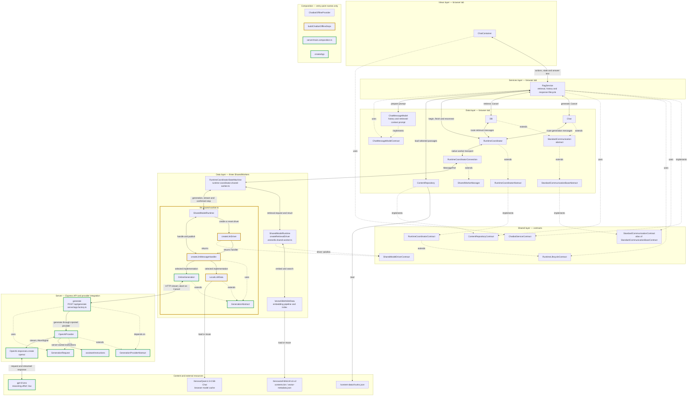

# RagService

[Source](../../assets/layers/services/chatbot.service.ts). The answering slice reuses browser retrieval and history for Local or Online generation. Streamed output and cancellation return through the coordinator; the API uses OpenAI only for generation.

Implementation: `ac22203a9ddd0d759712d1b5a8eed6195d41a3ae`. Comparison base: `df7fd5597ec6613af55ddba4506ca61ce6109e7c` (PR #23). The code is verified with controlled Online HTTP/model fixtures and a real Local CPU/cache journey. Live credentialed OpenAI access is unverified. Colors refer to this comparison.

Green borders identify added components or dependencies; yellow borders identify modified source; default borders identify unchanged or pure-moved code. Solid arrows show runtime calls/data; dotted arrows show type relationships. Composition remains disconnected. See [diagram maintenance and style](README.md).

