# TalkingHeadService

[Source](../../assets/layers/services/talking-head.service.ts). The head observes completed Local/Online generation output, uses browser speech and text-driven mouth animation for Local and Online answers. Mode composition supplies the shared generation instance; only RagService starts requests.

Implementation: `2d2df2a3d5d28daf2d001118ef0700d4f2f67038` (signed idle-avatar fix checkpoint). Both modes use native speech and text-driven mouth animation. The user approved the documented native-audio alternative. Initial camera setup and paused redraws are verified; missing-voice errors remain explicit. Reviews and the final suite for this fix are pending. Comparison base: `44e79ef4695dc7e24defb50981dd16ec21cf1179`. Green borders mark additions; yellow borders mark modified source; default borders mark unchanged components. Solid arrows show runtime calls/data; dotted arrows show type relationships. Composition remains disconnected. See [the architecture skill](../../.agents/skills/architecture-mermaid/SKILL.md).

```mermaid
flowchart TB
  subgraph Views["Views layer — browser tab"]
    UI["ChatContainer"]
    HeadUI["TalkingHeadComponent"]
  end
  subgraph Services["Services layer — browser tab"]
    Settings["ConfigurationService"]
    Rag["RagService"]
    Speech["TalkingHeadService"]
  end
  subgraph Contracts["Shared layer — contracts"]
    ServiceContract["ChatbotServiceContract"]
    SettingsContract["ConfigurationServiceContract"]
    GenerationContract["ChatGenerationContract"]
    GenerationState["ChatGenerationState"]
    Port["StandardCommunicationContract"]
    PortBase["StandardCommunicationBaseContract"]
    Session["ChatSessionContract"]
    HistoryContract["ChatHistoryRepositoryContract"]
    Lifecycle["RuntimeLifecycleContract"]
    RuntimeContract["RuntimeCoordinatorContract"]
    ContentContract["ContentRepositoryContract"]
    DriverContract["SharedModelDriverContract"]
    ApiContract["ApiContract"]
    MessagingContract["MessagingBaseContract"]
    SpeechContract["TalkingHeadServiceContract"]
    TTSContract["SpeechSynthesisContract"]
    HeadContract["TalkingHeadPresentationContract"]
    SpeechOutput["SpeechOutput"]
    SpeechState["TalkingHeadState"]
    SpeechOptions["TalkingHeadOptions"]
    ChatLifecycleEvent["ChatLifecycleEvent"]
    GenerationEvent["ChatGenerationEvent"]
  end
  subgraph Data["Data layer — browser tab"]
    subgraph DataContracts["Data contracts"]
      PromptContract["ChatMessageModelContract"]
      StoreContract["StoreContract"]
    end
    BrowserTTS["BrowserSpeechAdapter"]
    LipSync["BrowserSpeechLipSync"]
    Renderer["TalkingHeadAdapter"]
    Chat["Chat"]
    Online["OnlineChatClient"]
    ApiBase["ApiBase"]
    DB["DB"]
    Standard["StandardCommunication<br/>abstract"]
    StandardBase["StandardCommunicationBaseAbstract"]
    History["ChatHistoryRepository"]
    Identity["ConversationIdentity"]
    StorageBase["WebStorageBase — abstract"]
    IDB["IndexDBBase"]
    Content["ContentRepository"]
    Prompt["ChatMessageModel"]
    Coordinator["RuntimeCoordinator"]
    CoordinatorBase["RuntimeCoordinatorAbstract"]
    Connection["RuntimeCoordinatorConnection"]
    Transport["SharedWorkerManager"]
    WorkerBase["WorkerBase — abstract"]
  end
  subgraph Workers["Data layer — SharedWorkers"]
    Hub["RuntimeCoordinatorStateMachine<br/>runtime-coordinator.shared-worker.ts"]
    Retrieval["SharedModelRuntime<br/>createRetrievalDriver<br/>vectordb.shared-worker.ts"]
    Index["VectorDBHNSWData"]
    subgraph GenerationWorker["llm.shared-worker.ts"]
      Generation["SharedModelRuntime"]
      GenerationFactory["createLlmDriver"]
      Handler["createLlmMessageHandler"]
      Local["LocalLLMData"]
    end
  end
  subgraph SpeechLibraries["Speech and rendering — browser tab"]
    BrowserAPI["speechSynthesis / SpeechSynthesisUtterance"]
    Converter["LipsyncEn — TalkingHead"]
    TalkingHead["TalkingHead / Three.js<br/>rendering and Oculus visemes"]
  end
  subgraph Server["Server — Express API and provider integration"]
    API["generate — POST /api/generate"]
    DTO["GenerationRequest"]
    Provider["OpenAIProvider"]
    ProviderBase["GenerationProviderAbstract"]
    Instructions["assistantInstructions"]
    SDK["OpenAI.responses.create — openai"]
  end
  subgraph Resources["Storage, content and external resources"]
    IndexedDB["indexedDB — assistant-chat-history / conversations"]
    TabStorage["sessionStorage — current conversation ID"]
    Chunks["/content-data/chunks.json"]
    RetrievalAssets["Xenova/all-MiniLM-L6-v2<br/>contents.bin / vector-metadata.json"]
    LocalWeights["Xenova/Qwen1.5-0.5B-Chat"]
    Cache["CacheStorage — model files"]
    OpenAI["gpt-6-luna — low reasoning effort"]
    Avatar["avatars/mpfb.glb — CC0"]
  end
  subgraph Composition["Composition — names only"]
    Root["ChatbotProvider / buildChatbotDeps"]
    OfflineProvider["ChatbotOfflineProvider"]
    OnlineProvider["ChatbotOnlineProvider"]
    ModeBase["ChatbotModeProviderAbstract"]
    LocalFactory["buildChatbotOfflineDeps"]
    OnlineFactory["buildChatbotOnlineDeps"]
    ServiceFactory["buildRagService"]
    Context["chatbotCompositionContext"]
    ExistingContext["configurationContext / chatbotContext"]
    ServerComposition["server/main.composition.ts / createApp"]
  end
  Settings -.->|"implements"| SettingsContract
  UI <-->|"Send, Cancel, Reset, Retry; state and text"| Rag
  UI -.->|"uses"| ServiceContract
  Rag -.->|"implements"| ServiceContract
  Rag -.->|"retrieval dependency"| Port
  Rag -.->|"generation dependency"| GenerationContract
  GenerationContract -.->|"typed readiness and errors"| GenerationState
  Rag -.->|"uses"| Session
  Session -.->|"history dependency"| HistoryContract
  Session -.->|"optional runtime dependency"| Lifecycle
  RuntimeContract -.->|"extends"| Lifecycle
  Rag <-->|"generate / text updates / cancel"| Chat
  Rag <-->|"generate / text updates / cancel"| Online
  Rag <-->|"retrieve passages; cancel"| DB
  Rag <-->|"load, ordered save, clear"| History
  Identity -.->|"extends"| StorageBase
  Identity <-->|"reload-only conversation ID"| TabStorage
  History -.->|"implements"| HistoryContract
  History -->|"versioned open"| IDB
  History <-->|"transaction commit"| IndexedDB
  IDB -->|"open store"| IndexedDB
  IDB -.->|"implements"| StoreContract
  Rag <-->|"begin; finish after writes drain; reconnect"| Coordinator
  Rag -->|"successful explicit reconnect retries availability"| Settings
  Rag <-->|"load passages"| Content
  Rag -.->|"uses"| ContentContract
  Content -.->|"implements"| ContentContract
  Content -->|"read"| Chunks
  Content -.->|"extends"| ApiBase
  Rag <-->|"prepare context and completed history"| Prompt
  Rag -.->|"uses"| PromptContract
  Prompt -.->|"implements"| PromptContract
  Chat -.->|"extends"| Standard
  DB -.->|"extends"| Standard
  Standard -.->|"extends"| StandardBase
  Port -.->|"type alias"| PortBase
  StandardBase -.->|"implements"| PortBase
  Online -.->|"implements"| GenerationContract
  Chat -.->|"implements"| GenerationContract
  Online -.->|"extends"| ApiBase
  ApiBase -.->|"implements"| ApiContract
  Chat <-->|"Local generation messages"| Coordinator
  DB <-->|"retrieval messages"| Coordinator
  Coordinator -.->|"extends"| CoordinatorBase
  CoordinatorBase -.->|"implements"| RuntimeContract
  Coordinator <-->|"native transport"| Connection
  Connection -.->|"extends"| Transport
  Transport -.->|"extends"| WorkerBase
  WorkerBase -.->|"implements"| MessagingContract
  Connection <-->|"MessagePort"| Hub
  Hub <-->|"retrieval"| Retrieval
  Retrieval -.->|"driver satisfies"| DriverContract
  Retrieval <-->|"embed and search"| Index
  Index -->|"load"| RetrievalAssets
  Hub <-->|"Local FIFO generation and confirmed stop"| Generation
  Generation -->|"create driver"| GenerationFactory
  GenerationFactory -->|"return handler"| Handler
  GenerationFactory -.->|"returns"| DriverContract
  Generation <-->|"handle and publish"| Handler
  Handler <-->|"generate"| Local
  Local -->|"load"| LocalWeights
  Local -->|"Transformers.js cache"| Cache
  Index -->|"Transformers.js cache"| Cache
  Online <-->|"POST stream; AbortSignal"| API
  API -.->|"uses"| DTO
  API -.->|"provider contract"| ProviderBase
  API <-->|"injected provider"| Provider
  Provider -.->|"extends"| ProviderBase
  Provider -.->|"uses"| DTO
  Provider -->|"trusted instructions"| Instructions
  Provider <-->|"stream; AbortSignal"| SDK
  SDK <-->|"request and streamed response"| OpenAI
  Chat -->|"Local generation events; same instance"| Speech
  Online -->|"Online generation events; same instance"| Speech
  Speech -.->|"observes generation output"| GenerationContract
  Rag -->|"chat availability / invalidation; no answer text"| Speech
  Speech -.->|"observes lifecycle"| ServiceContract
  HeadUI <-->|"mount, Stop; status and playback lifecycle"| Speech
  HeadUI -.->|"uses"| SpeechContract
  Speech -.->|"implements"| SpeechContract
  Speech -.->|"synthesis dependency"| TTSContract
  Speech -.->|"presentation dependency"| HeadContract
  Speech <-->|"Local and Online: text"| BrowserTTS
  BrowserTTS -.->|"implements"| TTSContract
  BrowserTTS -->|"capability check"| BrowserAPI
  Renderer <-->|"speak, start, boundary, end, error, cancel"| BrowserAPI
  Renderer -->|"speech lifecycle and word position"| LipSync
  LipSync -->|"text to visemes"| Converter
  LipSync -->|"estimated timing; word-event alignment; mouth shapes"| TalkingHead
  Speech <-->|"mount, play, stop, dispose; playback state"| Renderer
  Renderer -.->|"implements"| HeadContract
  Renderer <-->|"avatar rendering, including paused resize/Stop, and viseme animation"| TalkingHead
  TalkingHead -->|"load avatar"| Avatar
  GenerationContract -.->|"read-only events"| GenerationEvent
  SpeechContract -.->|"state"| SpeechState
  TTSContract -.->|"synthesis output"| SpeechOutput
  HeadContract -.->|"playback input"| SpeechOutput
  ServiceContract -.->|"availability and invalidation"| ChatLifecycleEvent
  Speech -.->|"constructor options"| SpeechOptions
  classDef added stroke:#2da44e,stroke-width:3px;
  classDef modified stroke:#bf8700,stroke-width:3px;
  class LipSync,Converter,BrowserTTS,BrowserAPI,SpeechOutput,HeadUI,Speech,SpeechContract,TTSContract,HeadContract,Renderer,TalkingHead,Avatar,SpeechState,GenerationEvent,ChatLifecycleEvent,SpeechOptions added;
  class Chat,Online,GenerationContract,Rag,ServiceContract,ModeBase,ServiceFactory modified;
```

