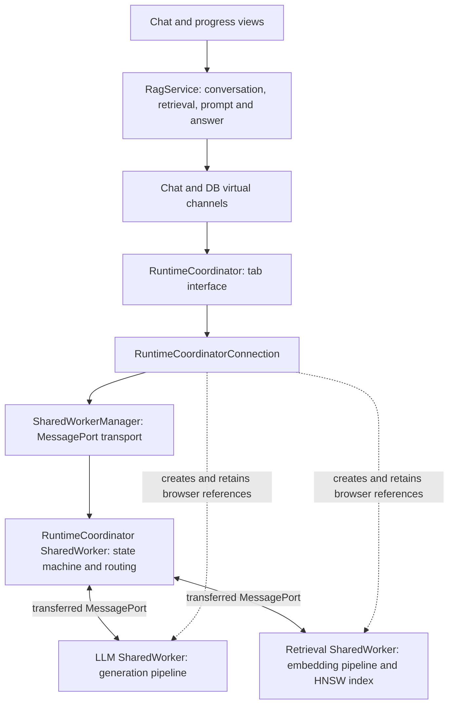

# Offline assistant runtime

The assistant uses three application SharedWorkers in a supported same-origin browser sharing context. Tabs keep separate conversations. Closing a tab cancels its work; it does not unload models used by another tab. Browser process loss can terminate all three workers.



Tab composition creates the three named worker connections and transfers model ports to RuntimeCoordinator. Tested Chromium SharedWorkers do not expose the dedicated Worker constructor. SharedWorkerManager retains the browser worker object and its native error subscription after port transfer. Each tab holds references to all three workers. Duplicate candidate ports close without changing the active binding or loading another pipeline.

RuntimeCoordinatorAbstract supplies the tab interface; RuntimeCoordinator starts its connection. RuntimeCoordinatorConnection handles attachment, model-port registration and browser lifecycle events. StandardCommunication and its base retain channel identity, subscriptions and replayed readiness/failure; Chat and DB provide typed configurations. ProgressService consumes replayable coordinator events. Generic BroadcastChannel utilities remain independent and are not used by this runtime.

The coordinator state machine owns resource state, initialization deduplication, client/request identity, per-resource queues, cancellation, accepted-response leases and configuration drain. Generation runs FIFO, one request at a time. RagService owns résumé retrieval, chunk loading, prompt construction, generation and tab-local history. No inference or conversation history lives in RuntimeCoordinator.

SharedModelRuntime adapts the actual generation and retrieval drivers to the shared-worker protocol. Each model worker reports its instance, loaded configuration, readiness, execution and actual stopping. Rebinding waits for initialization, execution and any in-flight disposal to settle before it can report readiness. Epochs reject old initialization and response messages. Cancellation suppresses subsequent chunks; a stop acknowledgment follows completion of the driver, not receipt of the cancel command. The generation driver yields to an event-loop task between model forward passes so CPU cancellation can be received.

## Departure and failure

`pagehide` detaches a tab and cancels its work; `pageshow` reconnects its transport. Visibility changes do not detach. Frozen or silently lost tabs can retain accepted work until its bounded deadline. Port-close events and native worker errors are advisory signals; request deadlines also cover silent loss. There are no Web Locks, ownership elections or heartbeats.

| Operation                                        | Default deadline |
| ------------------------------------------------ | ---------------- |
| Connection, registration or start acknowledgment | 10 seconds       |
| Model initialization or recovery                 | 10 minutes       |
| Request or whole accepted response               | 15 minutes       |
| Active request without model activity            | 2 minutes        |
| Actual cancellation stop                         | 30 seconds       |

A tab also times the whole accepted response, so coordinator loss after acceptance cannot strand its service forever. These are one-time operation timers, not idle liveness probes. The first attachment can select infrastructure policy; browser verification uses short deadlines.

Failures replay to late subscribers and remain visible until explicit recovery. The UI shows “Something went wrong” and a native, unstyled “reconnect” button. Repeated clicks share a recovery promise. Tabs release references to failed model workers, reattach the same named resources and retain healthy pipelines where possible. Recovery preserves conversation text and does not replay an interrupted question. An unresponsive model stays quarantined until a handshake confirms that prior work stopped; no second model is created to bypass a timeout. Bounded recovery can fail and remain visible.

## Configuration and storage

`begin(requestId)` / `finish(requestId)` cover the complete accepted response, including chunk loading and the retrieval-to-generation gap. A pending `configure` blocks new leases, drains existing leases and physical work, then updates shared resources. Generation-only settings reuse weights. Model/backend changes dispose the prior driver before initialization. Configuration controls and preference persistence belong to the later configuration ticket.

Transformers.js retains its Cache API support in both model SharedWorkers. Cached downloads survive worker shutdown and can be reused after browser restart. Loaded pipelines survive only while their worker lives. Browser storage can be evicted; persistence is not guaranteed. Application files, WASM, retrieval data and conversation history are separate from the model cache. Conversation history remains in the tab and is not persisted across browser sessions.

The old dedicated hub, dedicated model entry points, ownership-state SharedWorker and their exclusive managers/contracts have been removed after a consumer audit. Historical tickets and evidence describe the architecture they measured and intentionally retain old hub terminology. The current entry points are `runtime-coordinator.shared-worker.ts`, `llm.shared-worker.ts` and `vectordb.shared-worker.ts`.

## Verification

See [ticket 20261029-193942](../tasks/20261029-193942/TASK.md) and its retained evidence. The native controlled runner uses production runtime code and substitutes only model drivers; its UI checks also use a labelled chunk fixture. Those results do not establish real inference.

For real CPU checks, prepare the six résumé pages with the actual MiniLM model and browser HNSW serializer:

```sh
node scripts/prepare-retrieval-data.js --models /path/to/model-mirror --evidence /tmp/index-proof-new.json
RUNTIME_MODEL_DIR=/path/to/model-mirror npm run verify:browser -- --mode cache --evidence /tmp/cache-proof-new
RUNTIME_MODEL_DIR=/path/to/model-mirror npm run verify:browser -- --mode performance --evidence /tmp/performance-proof-new
```

Use the [supported toolchain](production-build.md). The mirror follows the Transformers.js model repository layout; `qwen.onnx` at its root is accepted for the Qwen q4 weight file. The real runner changes only its isolated build to WASM, one thread, 32 new tokens and deterministic generation. It serves local framework WASM. Cache verification blocks external DNS and the local `/models/` route after restarting the same profile and origin, then requires another visible answer with zero model requests. It also exercises real multi-tab answers, close, Cancel and Reset. Generated indices, model files, browser profiles and screenshots stay uncommitted.

Performance verification compares the actual shared generation path with the same handler, model, backend, prompt and generation settings in a dedicated Worker without cooperative yields. It records one warm-up and three measured answers per topology, checks identical outputs and measures actual stop acknowledgment. Small CPU samples are not a WebGPU result or a general performance guarantee.
