# Add a centered talking head that speaks assistant answers

- STATUS: OPEN
- PRIORITY: 200
- TAGS: task

## Background

Add a first talking-head prototype to the existing résumé assistant. A visitor asks a question through the current chat; the answer remains visible as text and the head speaks it with synchronized mouth movement. Center the head and give its canvas a visible, bounded size. Further visual styling is outside this ticket.

The user requested a new TATR and an intended architecture proposal, with technical decisions left open. On 2026-11-08, the user accepted sharing the active generation instance between RagService and TalkingHeadService as described below. The user then requested Autopilot implementation through PR handoff. Routine prototype choices are recorded below; implementation and verification are in progress.

Priority 200 places this requested next feature above the current open follow-ups. Search of OPEN and CLOSED tickets found no existing talking-head, avatar or speech ticket.

### Selected stack and upstream facts

| Part | Selection | What upstream documents |
| --- | --- | --- |
| Avatar | TalkingHead's MPFB `avatars/mpfb.glb` | This specific example asset is CC0; other example avatars have different licenses. |
| Rendering, animation and playback | TalkingHead, using Three.js | Browser WebGL renderer; accepts externally synthesized audio and timed Oculus visemes. TalkingHead is MIT. |
| Speech synthesis | HeadTTS with timestamped Kokoro | Browser synthesis with WebGPU or WASM in ordinary module Web Workers. HeadTTS is MIT; the timestamped Kokoro model is Apache-2.0. Current documented language support is English. |
| Synchronization | HeadTTS audio message | Contains words, phonemes, Oculus visemes and timing arrays. Its documented integration passes this message to TalkingHead's `speakAudio()`. A separate lip-sync model is not indicated. |

Sources checked on 2026-11-08: [TalkingHead documentation and avatar licensing](https://github.com/met4citizen/TalkingHead/blob/main/README.md), [TalkingHead license](https://github.com/met4citizen/TalkingHead/blob/main/LICENSE), [HeadTTS documentation](https://github.com/met4citizen/HeadTTS/blob/main/README.md), [HeadTTS license](https://github.com/met4citizen/HeadTTS/blob/main/LICENSE), [timestamped Kokoro model](https://huggingface.co/onnx-community/Kokoro-82M-v1.0-ONNX-timestamped). Pinned SDK versions are in package-lock.json; the avatar revision/hash and license are in static/avatars/README.md. Runtime observations are recorded separately below.

### Fit with the current application

Keep question handling, retrieval, generation and history in [RagService](../../assets/layers/services/rag.service.ts). Both `Chat` and `OnlineChatClient` already satisfy `ChatGenerationContract`, so both can supply answers to the same speech feature. Reuse `DB`, `ChatHistoryRepository`, the existing composition roots and the current worker infrastructure.

**Accepted generation boundary:** composition injects the same active `Chat` instance for Local, or `OnlineChatClient` instance for Online, into RagService and TalkingHeadService. RagService alone starts generation and retains retrieval, history and response ownership. TalkingHeadService observes output without starting another request or taking ownership of the generation instance.

Extend `ChatGenerationContract` with a read-only, non-replaying generation event subscription, implemented by both generation classes using the existing `createSubscribable` utility. Events identify the request and distinguish start, text delta, completion, cancellation and error. RagService can retain its existing callback/promise consumption; both consumers receive output from the same generation operation. Speech observes this normalized boundary rather than Local worker messages.

The existing `chatMessagesSubscription` remains the saved-conversation feed for `ChatContainer`. It includes restored history and growing snapshots, so it is not the speech source. Generation completion can precede successful history persistence: speech no longer waits for a save confirmation. This replaces the earlier proposal to deliver completed answer text from RagService after saving.

**Separate lifecycle connection:** a new question can start retrieval before generation begins, and Reset can run after generation ends while speech is still playing. `ChatbotServiceContract.lifecycleSubscription` emits invalidation and availability events for those actions and chat failures; composition wires it to TalkingHeadService. Generation cancellation/errors also invalidate speech. Speech disposal unsubscribes and stops playback; composition retains ownership of the shared generation instance. Failure of speech must leave generation, text chat and history usable.

Implementation responsibilities and locations:

| Area | Addition or modification | Responsibility |
| --- | --- | --- |
| Views | Add `TalkingHeadComponent` in `assets/layers/views/` | Supply the sized, centered mount area and plain speech controls/status; forward user actions. |
| Services | Add `TalkingHeadService` in `assets/layers/services/` | Observe the active generation instance, coordinate synthesis and playback, track the current request, and stop stale speech on generation or chat lifecycle signals. |
| Data | Add `HeadTTSAdapter` in `assets/layers/data/` | Translate the synthesis contract to HeadTTS; own initialization, asset loading and synthesis results. |
| Data | Add `TalkingHeadAdapter` in `assets/layers/data/` | Translate presentation operations to TalkingHead; own GLB loading, Three.js rendering, audio/viseme playback and cleanup. |
| Shared | Add focused service, synthesis and presentation contracts in `assets/layers/shared/contracts/` | Define the real layer boundaries and application-facing speech data. Use existing contract/type conventions. |
| Existing generation | Extend `ChatGenerationContract`, `Chat` and `OnlineChatClient` | Publish a consistent, read-only event feed from the existing generation operation, including request identity and terminal outcomes. |
| Existing service | Modify `RagService` and `ChatbotServiceContract` narrowly | Report chat lifecycle invalidation independently of generation output; retain retrieval, generation initiation and persistence responsibilities. |
| Composition | Extend the existing mode composition and `buildRagService` wiring as needed | Inject the same active generation instance into both services, wire chat lifecycle signals, and own cleanup. Decide whether expensive speech resources survive mode remounts before choosing their owner. |

The adapters isolate synthesis and presentation SDKs through shared contracts. No new generic manager, factory hierarchy or base class is proposed. Nothing needs removal at this stage. The view does not load models or reach directly into the data layer. Composition owns cross-layer wiring, following [the existing placement rules](../../README.md#dependency-and-helper-placement).

### Intended architecture

Implementation checkpoint: `1d74729449d09d8e57b7e0b4e6bbb6a942a7c154`. This diagram now describes the current source; full runtime verification and reviews remain in progress. Green means added, yellow means modified source, and solid/dotted arrows distinguish runtime/type relationships. Composition is disconnected. Saved copies are under docs/architecture/. Comparison base: `44e79ef4695dc7e24defb50981dd16ec21cf1179`.

```mermaid
flowchart TB
  subgraph Views["Views layer — browser tab"]
    UI["ChatContainer"]
    HeadUI["TalkingHeadComponent"]
  end
  subgraph Services["Services layer — browser tab"]
    Settings["ConfigurationService"]
    Rag["RagService"]
    Speech["TalkingHeadService"]
  end
  subgraph Contracts["Shared layer — contracts"]
    ServiceContract["ChatbotServiceContract"]
    SettingsContract["ConfigurationServiceContract"]
    GenerationContract["ChatGenerationContract"]
    GenerationState["ChatGenerationState"]
    Port["StandardCommunicationContract"]
    PortBase["StandardCommunicationBaseContract"]
    Session["ChatSessionContract"]
    HistoryContract["ChatHistoryRepositoryContract"]
    Lifecycle["RuntimeLifecycleContract"]
    RuntimeContract["RuntimeCoordinatorContract"]
    ContentContract["ContentRepositoryContract"]
    DriverContract["SharedModelDriverContract"]
    ApiContract["ApiContract"]
    MessagingContract["MessagingBaseContract"]
    SpeechContract["TalkingHeadServiceContract"]
    TTSContract["SpeechSynthesisContract"]
    HeadContract["TalkingHeadPresentationContract"]
    SpeechAudio["SpeechAudio"]
    SpeechOutput["SpeechOutput"]
    SpeechState["TalkingHeadState"]
    SpeechOptions["TalkingHeadOptions"]
    ChatLifecycleEvent["ChatLifecycleEvent"]
    GenerationEvent["ChatGenerationEvent"]
  end
  subgraph Data["Data layer — browser tab"]
    subgraph DataContracts["Data contracts"]
      PromptContract["ChatMessageModelContract"]
      StoreContract["StoreContract"]
    end
    TTS["HeadTTSAdapter"]
    BrowserTTS["BrowserSpeechAdapter"]
    LipSync["BrowserSpeechLipSync"]
    Renderer["TalkingHeadAdapter"]
    Chat["Chat"]
    Online["OnlineChatClient"]
    ApiBase["ApiBase"]
    DB["DB"]
    Standard["StandardCommunication<br/>abstract"]
    StandardBase["StandardCommunicationBaseAbstract"]
    History["ChatHistoryRepository"]
    Identity["ConversationIdentity"]
    StorageBase["WebStorageBase — abstract"]
    IDB["IndexDBBase"]
    Content["ContentRepository"]
    Prompt["ChatMessageModel"]
    Coordinator["RuntimeCoordinator"]
    CoordinatorBase["RuntimeCoordinatorAbstract"]
    Connection["RuntimeCoordinatorConnection"]
    Transport["SharedWorkerManager"]
    WorkerBase["WorkerBase — abstract"]
  end
  subgraph Workers["Data layer — SharedWorkers"]
    Hub["RuntimeCoordinatorStateMachine<br/>runtime-coordinator.shared-worker.ts"]
    Retrieval["SharedModelRuntime<br/>createRetrievalDriver<br/>vectordb.shared-worker.ts"]
    Index["VectorDBHNSWData"]
    subgraph GenerationWorker["llm.shared-worker.ts"]
      Generation["SharedModelRuntime"]
      GenerationFactory["createLlmDriver"]
      Handler["createLlmMessageHandler"]
      Local["LocalLLMData"]
    end
  end
  subgraph SpeechLibraries["Speech SDKs — browser tab and dedicated Worker"]
    HeadTTS["HeadTTS / Kokoro<br/>HeadTTS browser module"]
    SpeechWorker["head-tts.worker.js<br/>worker-tts.mjs — HeadTTS"]
    BrowserAPI["speechSynthesis / SpeechSynthesisUtterance"]
    Converter["LipsyncEn — TalkingHead"]
    TalkingHead["TalkingHead / Three.js<br/>rendering, audio and Oculus visemes"]
  end
  subgraph Server["Server — Express API and provider integration"]
    API["generate — POST /api/generate"]
    DTO["GenerationRequest"]
    Provider["OpenAIProvider"]
    ProviderBase["GenerationProviderAbstract"]
    Instructions["assistantInstructions"]
    SDK["OpenAI.responses.create — openai"]
  end
  subgraph Resources["Storage, content and external resources"]
    IndexedDB["indexedDB — assistant-chat-history / conversations"]
    TabStorage["sessionStorage — current conversation ID"]
    Chunks["/content-data/chunks.json"]
    RetrievalAssets["Xenova/all-MiniLM-L6-v2<br/>contents.bin / vector-metadata.json"]
    LocalWeights["Xenova/Qwen1.5-0.5B-Chat"]
    Cache["CacheStorage — model files"]
    OpenAI["gpt-6-luna — low reasoning effort"]
    Avatar["avatars/mpfb.glb — CC0"]
    SpeechAssets["Kokoro-82M-v1.0-ONNX-timestamped<br/>voices / dictionaries / runtime assets"]
  end
  subgraph Composition["Composition — names only"]
    Root["ChatbotProvider / buildChatbotDeps"]
    OfflineProvider["ChatbotOfflineProvider"]
    OnlineProvider["ChatbotOnlineProvider"]
    ModeBase["ChatbotModeProviderAbstract"]
    LocalFactory["buildChatbotOfflineDeps"]
    OnlineFactory["buildChatbotOnlineDeps"]
    ServiceFactory["buildRagService"]
    Context["chatbotCompositionContext"]
    ExistingContext["configurationContext / chatbotContext"]
    ServerComposition["server/main.composition.ts / createApp"]
  end
  Settings -.->|"implements"| SettingsContract
  UI <-->|"Send, Cancel, Reset, Retry; state and text"| Rag
  UI -.->|"uses"| ServiceContract
  Rag -.->|"implements"| ServiceContract
  Rag -.->|"retrieval dependency"| Port
  Rag -.->|"generation dependency"| GenerationContract
  GenerationContract -.->|"typed readiness and errors"| GenerationState
  Rag -.->|"uses"| Session
  Session -.->|"history dependency"| HistoryContract
  Session -.->|"optional runtime dependency"| Lifecycle
  RuntimeContract -.->|"extends"| Lifecycle
  Rag <-->|"generate / text updates / cancel"| Chat
  Rag <-->|"generate / text updates / cancel"| Online
  Rag <-->|"retrieve passages; cancel"| DB
  Rag <-->|"load, ordered save, clear"| History
  Identity -.->|"extends"| StorageBase
  Identity <-->|"reload-only conversation ID"| TabStorage
  History -.->|"implements"| HistoryContract
  History -->|"versioned open"| IDB
  History <-->|"transaction commit"| IndexedDB
  IDB -->|"open store"| IndexedDB
  IDB -.->|"implements"| StoreContract
  Rag <-->|"begin; finish after writes drain; reconnect"| Coordinator
  Rag -->|"successful explicit reconnect retries availability"| Settings
  Rag <-->|"load passages"| Content
  Rag -.->|"uses"| ContentContract
  Content -.->|"implements"| ContentContract
  Content -->|"read"| Chunks
  Content -.->|"extends"| ApiBase
  Rag <-->|"prepare context and completed history"| Prompt
  Rag -.->|"uses"| PromptContract
  Prompt -.->|"implements"| PromptContract
  Chat -.->|"extends"| Standard
  DB -.->|"extends"| Standard
  Standard -.->|"extends"| StandardBase
  Port -.->|"type alias"| PortBase
  StandardBase -.->|"implements"| PortBase
  Online -.->|"implements"| GenerationContract
  Chat -.->|"implements"| GenerationContract
  Online -.->|"extends"| ApiBase
  ApiBase -.->|"implements"| ApiContract
  Chat <-->|"Local generation messages"| Coordinator
  DB <-->|"retrieval messages"| Coordinator
  Coordinator -.->|"extends"| CoordinatorBase
  CoordinatorBase -.->|"implements"| RuntimeContract
  Coordinator <-->|"native transport"| Connection
  Connection -.->|"extends"| Transport
  Transport -.->|"extends"| WorkerBase
  WorkerBase -.->|"implements"| MessagingContract
  Connection <-->|"MessagePort"| Hub
  Hub <-->|"retrieval"| Retrieval
  Retrieval -.->|"driver satisfies"| DriverContract
  Retrieval <-->|"embed and search"| Index
  Index -->|"load"| RetrievalAssets
  Hub <-->|"Local FIFO generation and confirmed stop"| Generation
  Generation -->|"create driver"| GenerationFactory
  GenerationFactory -->|"return handler"| Handler
  GenerationFactory -.->|"returns"| DriverContract
  Generation <-->|"handle and publish"| Handler
  Handler <-->|"generate"| Local
  Local -->|"load"| LocalWeights
  Local -->|"Transformers.js cache"| Cache
  Index -->|"Transformers.js cache"| Cache
  Online <-->|"POST stream; AbortSignal"| API
  API -.->|"uses"| DTO
  API -.->|"provider contract"| ProviderBase
  API <-->|"injected provider"| Provider
  Provider -.->|"extends"| ProviderBase
  Provider -.->|"uses"| DTO
  Provider -->|"trusted instructions"| Instructions
  Provider <-->|"stream; AbortSignal"| SDK
  SDK <-->|"request and streamed response"| OpenAI
  Chat -->|"Local generation events; same instance"| Speech
  Online -->|"Online generation events; same instance"| Speech
  Speech -.->|"observes generation output"| GenerationContract
  Rag -->|"chat availability / invalidation; no answer text"| Speech
  Speech -.->|"observes lifecycle"| ServiceContract
  HeadUI <-->|"mount, Stop; status and playback lifecycle"| Speech
  HeadUI -.->|"uses"| SpeechContract
  Speech -.->|"implements"| SpeechContract
  Speech -.->|"synthesis dependency"| TTSContract
  Speech -.->|"presentation dependency"| HeadContract
  Speech <-->|"Online: text; audio/timings; release idle model"| TTS
  Speech <-->|"Local: text"| BrowserTTS
  BrowserTTS -.->|"implements"| TTSContract
  BrowserTTS -->|"capability check"| BrowserAPI
  Renderer <-->|"Local: speak, start, boundary, end, error, cancel"| BrowserAPI
  Renderer -->|"Local speech lifecycle and word position"| LipSync
  LipSync -->|"text to visemes"| Converter
  LipSync -->|"estimated timing; word-event alignment; mouth shapes"| TalkingHead
  TTS -.->|"implements"| TTSContract
  TTS <-->|"initialize and synthesize"| HeadTTS
  HeadTTS <-->|"synthesis messages"| SpeechWorker
  SpeechWorker -->|"model / voice / dictionary loading and caches"| SpeechAssets
  Speech <-->|"mount, play, stop, dispose; playback state"| Renderer
  Renderer -.->|"implements"| HeadContract
  Renderer <-->|"synchronized audio and animation"| TalkingHead
  TalkingHead -->|"load avatar"| Avatar
  GenerationContract -.->|"read-only events"| GenerationEvent
  SpeechContract -.->|"state"| SpeechState
  TTSContract -.->|"synthesis output"| SpeechOutput
  SpeechOutput -.->|"Online audio and timed visemes"| SpeechAudio
  HeadContract -.->|"playback input"| SpeechOutput
  ServiceContract -.->|"availability and invalidation"| ChatLifecycleEvent
  Speech -.->|"constructor options"| SpeechOptions
  classDef added stroke:#2da44e,stroke-width:3px;
  classDef modified stroke:#bf8700,stroke-width:3px;
  class LipSync,Converter,BrowserTTS,BrowserAPI,SpeechOutput,HeadUI,Speech,SpeechContract,TTSContract,HeadContract,TTS,Renderer,HeadTTS,TalkingHead,Avatar,SpeechAssets,SpeechWorker,SpeechAudio,SpeechState,GenerationEvent,ChatLifecycleEvent,SpeechOptions added;
  class Chat,Online,GenerationContract,Rag,ServiceContract,ModeBase,ServiceFactory modified;
```

## Prerequisites

- Current stage: stage 4 runtime verification, blocked on native browser voice availability and the real Online-to-Local journey. Local now uses browser speech; the fresh Local text path passes, but this Chromium installation exposes no system voices. The mode-switch memory failure remains open. Mode: Autopilot through PR handoff, explicitly requested by the user on 2026-11-08. Scope includes routine implementation decisions, tests, in-scope documentation and Mermaid skill changes, signed commits, push, PR and CI/review fixes. Merge and deployment require separate authorization.
- Branch: `feature/20261108-123438-talking-head`. Fixed review base: `44e79ef4695dc7e24defb50981dd16ec21cf1179`.
- Initial delivery: speak each completed new English answer once after a plain Enable speech action; plain Stop control; centered 320-by-320 mount constrained to available width. Additional voice selection, microphone input and sentence streaming are deferred.
- Test seams: normalized generation events (one request, correlated output, terminal cancellation/errors, observer isolation); TalkingHeadService with controlled synthesis/presentation (stale work, reset, disposal and playback failure); real browser SDK integration (GLB, audible synthesis, timed animation, cached reload and cleanup). Focused commands: `node --import ./scripts/typescript-test.loader.js --test tests/chat-generation.spec.js tests/online-generation.spec.js tests/talking-head.spec.js`, `npm run typecheck`, `npm run lint`; browser journeys extend the existing verification runner. The final required suite also includes `npm test` and `npm run build`.
- Browser proof targets: visible framed head, nonempty synthesized audio with corresponding visemes, responsive Stop/Reset, no duplicate generation, no stale playback after reset or remount, cached assets reusable after reload. Record cold/warm first-audio delay and responsiveness with Local inference; these are prototype measurements, not a hardware-wide performance guarantee.
- Selected delivery: each newly completed answer speaks once after Enable speech. Stop speech stops the current utterance; Reset/new questions/errors invalidate work. Local uses browser speech with approximate text-driven mouth animation; Online uses English af_bella, WASM/Q4 and one dedicated HeadTTS Worker per enabled tab. Sentence streaming, voice selection, microphone input and emotion inference are deferred.
- Lifecycle uses the non-replaying invalidation subscription described above for a new question, Cancel/Reset, chat/storage failures and mode changes. The accepted design requires an explicit stop/invalidation path beyond generation events, including when generation has finished or retrieval has only just started. Stop pending/current speech while preserving history according to the existing chat action; the existing generation Cancel button alone is insufficient.
- Resource ownership: each mode composition owns TalkingHeadService and its adapters; feature removal also disposes its service idempotently. The generation instance remains composition-owned. Online HeadTTS executes in a dedicated Worker; Local browser speech starts no speech Worker. Renderer/audio stay in the tab. Keep rendering/audio associated with the visible tab. HeadTTS's documented Worker is not a SharedWorker; do not add another application SharedWorker or alter RuntimeCoordinator's responsibilities without evidence and an agreed design. Check the accepted [runtime ADR](../../docs/adr/0002-share-assistant-resources-through-runtimecoordinator-and-two-model-sharedworkers.md) before changing model sharing.
- Cancellation and cleanup checks: [HeadTTS source](https://github.com/met4citizen/HeadTTS/blob/main/modules/headtts.mjs) clears queues but does not establish that active inference is aborted; its documented API lacks a simple disposal operation. Stale results must be ignored, and teardown/resource reuse must be demonstrated. [TalkingHead source](https://github.com/met4citizen/TalkingHead/blob/main/modules/talkinghead.mjs) provides playback stop and disposal mechanisms to verify.
- Asset/cache policy and checks: model, voices, tokenizer, dictionaries, GLB, modules and WASM. [HeadTTS worker](https://github.com/met4citizen/HeadTTS/blob/main/modules/worker-tts.mjs) uses Transformers.js for model loading but plain fetch for some other assets. Existing model caching does not prove all speech assets are available offline. Measure initial and cached startup, time to first audio, rendering responsiveness and resource use alongside Local generation; agree supported browser/device targets and acceptable limits before closing the prototype.
- No paid TTS credentials are needed for the candidate browser path. If OpenAI credentials remain unavailable, verify Online integration through the existing controlled API seam and disclose that live OpenAI access was not tested.

## Acceptance criteria

The functional target and shared generation subscription are accepted. Autopilot selected completed-answer speech, explicit activation, plain Stop, and text-preserving failure fallback for the first prototype.

- [ ] A visible 3D head is centered in a canvas with explicit usable dimensions and fits the available viewport. Only sizing, centering and functional plain controls are added.
- [ ] Feeding text through the feature produces speech using the selected mode: Local browser speech with approximate text-driven mouth animation, Online Kokoro audio with synchronized mouth movement.
- [ ] A newly generated answer from either Local or Online follows the same head/speech path and corresponds to the text answer. Existing question entry, retrieval, streaming text and history remain usable.
- [ ] Composition injects the same active generation instance into RagService and TalkingHeadService. One question starts one generation operation, initiated only by RagService; speech observes request-scoped output through the shared contract in both modes.
- [ ] Generation subscriptions do not replay earlier output, and distinguish text, completion, cancellation and errors. Speech receives output independently of history-save completion. Speech failures or observer disposal do not fail generation, dispose its instance or prevent text/history updates.
- [ ] The agreed delivery policy distinguishes a live answer from restored history, partial snapshots, interrupted answers and duplicate callbacks. Reload, reconnect and mode changes do not automatically speak old history.
- [ ] Stop, Cancel, Reset, a replacement question and component disposal follow the agreed lifecycle policy. Obsolete synthesis or playback callbacks cannot restart speech or animate a replaced component.
- [ ] Lifecycle verification covers Reset after generation completion, a new question while retrieval is pending, and a save failure after generation output. Each invalidates pending/current speech through the agreed lifecycle connection without replaying a generation request.
- [ ] A browser-required audio activation action is handled visibly. Avatar, synthesis, playback or capability failures show useful plain status while leaving text chat usable. Only the originating tab speaks its answer.
- [ ] Resource ownership is demonstrated across Local/Online remounts and multiple tabs: audio, animation loops, subscriptions and workers are stopped, released or deliberately reused. No unintended duplicate playback or accumulating synthesis instances occur.
- [ ] Selected model and asset caching works according to the agreed policy, including a measured cached run. Document the actual offline asset coverage and browser eviction limits instead of inferring them from the LLM cache.
- [ ] Initial load, cached startup, first-audio delay and Local-generation coexistence are measured against agreed targets. Lip synchronization is verified with real audio and visible motion, not a static screenshot alone.

## Dependencies

**Blocking tickets:** None identified. Real browser verification, reviews and the final required suite remain completion gates.

**Existing foundations:** [Local/Online composition and persisted history](../20261105-222408/TASK.md) and [RuntimeCoordinator with three SharedWorkers](../20261029-193942/TASK.md) are merged. Reuse their current contracts and ownership rules.

**Related follow-ups, not blockers:** [Saved conversation selection](../20261106-125405/TASK.md) must eventually preserve the rule against automatically speaking restored history. [Persisted-history context limits](../20261106-135948/TASK.md) remains separate. [Coordinator reconnect verification](../20261105-222407/TASK.md) is an existing investigation; this feature does not claim to fix it.

## Definition of Done

- [ ] Record selected versions/licenses, class boundaries, lifecycle policies, environment, measured performance limits and implementation mode in this ticket.
- [ ] Verify the acceptance criteria through focused service/adapter checks and actual browser journeys: direct text, Local answer, controlled or live Online answer, cached startup, Stop/Reset, reload/history restoration, mode switching and failure fallback. Record coverage gaps explicitly.
- [ ] Complete the repository implementation flow, including deslop, independent reviews and the final required suite (`npm test`, `npm run typecheck`, `npm run lint`, and `npm run build`, with Hugo available). Extend the reusable verification skill/helper only where this feature requires it.
- [ ] Save the implemented service slice and update affected service/application diagrams in `docs/architecture/` with exact implemented names, contracts, abstracts, disconnected composition boxes and the standard green/yellow borders. Until then, keep future architecture in this ticket.
- [ ] Commit reusable verification assets and concise results. Preserve routine screenshots, audio/video and reports in ignored `artifacts/verification/<run-id>/`, publish retained links with tested revision and outcomes, and prove evidence survives cleanup. Do not commit routine execution evidence.

### Implementation progress

2026-11-08: generation events, head service, SDK adapters, view and composition are implemented. Focused generation/history/lifecycle/build checks pass; current runtime verification is in progress. Real Online/Kokoro and cached browser restart passed. The real Local transition exposed a browser memory failure while idle Kokoro remained resident; the fix releases idle speech workers on configuration unavailability while keeping them warm during stable configuration and blocks voice initialization while configuration is unavailable. New behavioral checks cover that resource policy. CPU speech latency is about one minute for a short reply in this software-rendered environment. Full Local/coexistence proof, reviews and final publication remain pending.

### Verification checkpoint

Stage 4 remains blocked by real-model coexistence. `npm run verify:browser -- --mode speech` passes with real MPFB/Kokoro and controlled Local/Online generation, including nonzero decoded audio, mouth animation observed in retained video, a WAV clip, Stop/Reset, one Local request, and cached speech after browser restart with outbound DNS blocked. The latest waveform run is under ignored artifacts/verification/speech-2026-11-08T18-35-22-469Z-e7e070c6-8d39-4aa7-8908-b815090562c4/. These are local-only artifacts until publication.

The real Local variant with `RUNTIME_MODEL_DIR=/workspace/scratch/three-sharedworkers/source-models` fails when the 8 GB cgroup kills a browser renderer during generation/speech coexistence. Release-on-configuration, release-before-Local-generation, and idle-render pause reduce resource overlap but do not establish a passing real-model journey here. A separate isolated run of the same real Qwen question, with speech disabled, returned “Rasmus has worked at Ericsson for several years.” This confirms a coexistence blocker rather than treating the controlled driver as real inference. No larger-memory or hardware-GPU verification has been performed.

Focused generation, persistence/lifecycle, speech and asset checks pass 58/58. Typecheck, lint and production build pass after cleanup. Production build and the existing Online browser journey pass. Five architecture diagrams render; metadata remains explicitly uncommitted/partial until the checkpoint commit. Independent reviews, final full-suite result, push and PR handoff are pending. The ticket stays OPEN.

Final controlled checkpoint: `npm run verify:browser -- --mode speech` PASS after helper cleanup, with screenshot, video and nonzero PCM WAV retained under ignored artifacts/verification/speech-2026-11-08T18-41-20-154Z-0a46d648-c220-4710-b4c7-06fdc287b9ac/. Source digest: `a97875bd83300a684899f7e32282cc6abe1dd46fa366d193185b502f5e28a2e6`. The real-model mode-switch journey remains FAIL; the isolated no-voice real-Qwen diagnostic passes. Stage 4 requires a passing real-model journey or user-approved alternative verification before review/publication. No PR has been opened.

Signed implementation checkpoint: `1d74729449d09d8e57b7e0b4e6bbb6a942a7c154`. Stage 4 is blocked; no reviews, final full-suite claim, push or PR publication have occurred. A following documentation/formatting checkpoint updates diagram provenance and removes a trailing blank line; runtime behavior is unchanged.

### Browser memory investigation

At `6797ddb`, diagnostic runs measured Chromium through CDP `Runtime.getHeapUsage` and memory-infra process dumps, with a 500 ms operating-system PSS cross-check of the owned browser process tree. PSS counts shared physical pages proportionally. No forced garbage collection or production header changes were used. Chrome's private-footprint reports also show that most memory is outside the reported JavaScript heaps; those heaps alone cannot account for the models. The page-level `measureUserAgentSpecificMemory` API was unavailable in this non-isolated deployment.

- Fresh Local, speech disabled: real answer PASS; sampled browser peak 5.86 GiB.
- Fresh Local, speech enabled: real Qwen answer and Kokoro playback PASS; sampled browser peak 6.34 GiB. The same answer was returned in both fresh-session runs.
- Original Online-to-Local journey: text generation completed, then an out-of-memory kill occurred while speech was loading. The last sampled browser peak was 6.42 GiB; the whole environment reached its 8 GiB limit. The cgroup kill count increased from 4 to 5. Samples can miss a shorter allocation peak. The failed owned page was subsequently closed to end its pending audio wait; a duplicate target-close error occurred during helper teardown. Browser, server and temporary profile cleanup completed.

These results establish a working fresh Local path and a failing mode-switch path. They do not establish a memory leak or prove that more RAM is the required fix. Investigate resource release and temporary allocations across the switch and voice reload. The earlier 8 GiB figure describes the environment limit, not the browser's measured allocation. No verification substitution has been approved. Stage 4 remains OPEN.

Local-only evidence: ignored `artifacts/verification/memory-local-only-1794165064840/`, `memory-combined-1794165123848/` and `memory-full-journey-1794165329398/`, each containing source-linked reports, memory samples and Chrome traces. These files survived cleanup and are not committed. The five saved architecture diagrams were checked; diagnostics changed no application classes or wiring. Reviews, final full-suite testing, push and PR remain pending.

### Local browser speech change

The user requested removing Kokoro from Local speech. Each mode composition now supplies its synthesis dependency explicitly: buildChatbotOfflineDeps supplies BrowserSpeechAdapter, and buildChatbotOnlineDeps retains HeadTTSAdapter. SpeechOutput carries either browser text or Online audio/timings. TalkingHeadAdapter owns native speak/end/error/cancel handling as well as its existing audio playback. Local starts no speech Worker and downloads no Kokoro weights; the head remains still because native speech supplies no timed visemes. The old release-before-Local-generation option is removed. Stop, Reset and disposal use the existing abort/invalidation path. Disposing native playback also settles its pending promise.

A fresh Local diagnostic with real retrieval/Qwen returned “Rasmus has worked at Ericsson for several years.” It observed zero speech Workers, a 5.90 GiB sampled browser PSS peak and no new OOM kill. Native speech then returned synthesis-failed; Chromium exposes zero voices. This proves the text/error path, not audible native speech. Local-only evidence: ignored artifacts/verification/memory-browser-local-1794171220826/. An earlier full real-model Online-to-Local run still suffered an OOM kill during the Local question; it does not establish that the mode-switch issue is fixed. That run also overlapped build work, so it is not a clean comparative memory benchmark.

Five native API tests cover completion, cancellation, error/retry, missing capability and disposal; the six service lifecycle tests pass. The broader 61-check focused run passed before the final disposal regression was added, and the affected 11-check run passes afterward. Typecheck, lint and production build pass. Five saved diagrams render, with Local browser speech and Online Kokoro shown separately. Native audible output and the full mode-switch journey remain verification gates. Stage 4 remains OPEN; both independent reviews, blast-radius review, final full-suite result and PR handoff remain invalid/unperformed. Routine evidence is ignored; no PR has been opened.

Current-source browser run: `npm run verify:browser -- --mode speech` reports BLOCKED at Local native speech with synthesis-failed and zero available voices. Online Kokoro audio, Stop/Reset and Local transition ran first; Local had zero dedicated speech Workers. The Local answer was retained, and browser/server/profile cleanup passed with evidence retained. Cached restart was not reached. Report and visual artifacts are local-only under ignored artifacts/verification/speech-2026-11-08T20-55-34-398Z-8b191396-2c26-46cf-9e49-62d8a915202f/. This is a prerequisite blocker, not a passing native-audio journey or an approved substitution.

Signed Local browser-speech implementation checkpoint: `2feecb4df66a81ac5be7fd932f6b6e6ceb77c400`. Stage 4 remains OPEN on the recorded runtime blockers. Saved diagram provenance now identifies this snapshot; no application code changed in the provenance update.

### Local text-driven mouth animation

User approved text-to-mouth conversion with word-boundary alignment and estimated timing as the fallback. BrowserSpeechLipSync lives in the Data layer's utils folder and reuses TalkingHead's statically bundled LipsyncEn rules. It estimates word/viseme timing from text and speech rate, starts only on native speech start, and aligns the timeline to reported word charIndex values. Completion, cancellation, failure and disposal stop scheduling and close the mouth. It adds no inference model, Worker or audio buffer. Online timed-audio playback is unchanged. Four timing checks cover the no-boundary path, word realignment, cancellation/late callbacks and punctuation. Native speech and audible alignment remain blocked by zero system voices; controlled animation events do not replace that missing evidence. Reviews and final full-suite claims remain invalid pending stage 4 completion.

2026-11-09 animation checkpoint: 15 focused timing/native-speech/service tests pass. Typecheck, lint and production build pass; all five saved diagrams rendered. A real-avatar browser probe with explicitly controlled start/word/end events returns to ready, retains zero speech Workers and records an applied mouth-opening morph of 0.475 in a separate direct-render probe of the same helper and SDK. The direct-render image shows an open mouth; the application probe captures completion with the mouth closed. Initial setValue-based motion was too slow, so the helper now uses TalkingHead's existing viseme animation queue. The signed snapshot includes the reusable timing tests; routine screenshots/video/reports remain ignored at artifacts/verification/native-mouth-1794173640536/. These checks prove rendered text-driven motion, not audible native synchronization. Stage 4 stays OPEN for the existing native-voice and mode-switch blockers; no PR or verification waiver is claimed.
