# Add a centered talking head that speaks assistant answers

- STATUS: OPEN
- PRIORITY: 200
- TAGS: task

## Background

Add a first talking-head prototype to the existing résumé assistant. A visitor asks a question through the current chat; the answer remains visible as text and the head speaks it with synchronized mouth movement. Center the head and give its canvas a visible, bounded size. Further visual styling is outside this ticket.

The user requested a new TATR and an intended architecture proposal, with technical decisions left open. On 2026-11-08, the user accepted sharing the active generation instance between RagService and TalkingHeadService as described below. The user then requested Autopilot implementation through PR handoff. Routine prototype choices are recorded below; implementation and verification are in progress.

Priority 200 places this requested next feature above the current open follow-ups. Search of OPEN and CLOSED tickets found no existing talking-head, avatar or speech ticket.

### Selected stack and upstream facts

| Part | Selection | What upstream documents |
| --- | --- | --- |
| Avatar | TalkingHead's MPFB `avatars/mpfb.glb` | This specific example asset is CC0; other example avatars have different licenses. |
| Rendering, animation and playback | TalkingHead, using Three.js | Browser WebGL renderer; accepts externally synthesized audio and timed Oculus visemes. TalkingHead is MIT. |
| Speech synthesis | HeadTTS with timestamped Kokoro | Browser synthesis with WebGPU or WASM in ordinary module Web Workers. HeadTTS is MIT; the timestamped Kokoro model is Apache-2.0. Current documented language support is English. |
| Synchronization | HeadTTS audio message | Contains words, phonemes, Oculus visemes and timing arrays. Its documented integration passes this message to TalkingHead's `speakAudio()`. A separate lip-sync model is not indicated. |

Sources checked on 2026-11-08: [TalkingHead documentation and avatar licensing](https://github.com/met4citizen/TalkingHead/blob/main/README.md), [TalkingHead license](https://github.com/met4citizen/TalkingHead/blob/main/LICENSE), [HeadTTS documentation](https://github.com/met4citizen/HeadTTS/blob/main/README.md), [HeadTTS license](https://github.com/met4citizen/HeadTTS/blob/main/LICENSE), [timestamped Kokoro model](https://huggingface.co/onnx-community/Kokoro-82M-v1.0-ONNX-timestamped). Pinned SDK versions are in package-lock.json; the avatar revision/hash and license are in static/avatars/README.md. Runtime observations are recorded separately below.

### Fit with the current application

Keep question handling, retrieval, generation and history in [RagService](../../assets/layers/services/rag.service.ts). Both `Chat` and `OnlineChatClient` already satisfy `ChatGenerationContract`, so both can supply answers to the same speech feature. Reuse `DB`, `ChatHistoryRepository`, the existing composition roots and the current worker infrastructure.

**Accepted generation boundary:** composition injects the same active `Chat` instance for Local, or `OnlineChatClient` instance for Online, into RagService and TalkingHeadService. RagService alone starts generation and retains retrieval, history and response ownership. TalkingHeadService observes output without starting another request or taking ownership of the generation instance.

Extend `ChatGenerationContract` with a read-only, non-replaying generation event subscription, implemented by both generation classes using the existing `createSubscribable` utility. Events identify the request and distinguish start, text delta, completion, cancellation and error. RagService can retain its existing callback/promise consumption; both consumers receive output from the same generation operation. Speech observes this normalized boundary rather than Local worker messages.

The existing `chatMessagesSubscription` remains the saved-conversation feed for `ChatContainer`. It includes restored history and growing snapshots, so it is not the speech source. Generation completion can precede successful history persistence: speech no longer waits for a save confirmation. This replaces the earlier proposal to deliver completed answer text from RagService after saving.

**Separate lifecycle connection:** a new question can start retrieval before generation begins, and Reset can run after generation ends while speech is still playing. `ChatbotServiceContract.lifecycleSubscription` emits invalidation and availability events for those actions and chat failures; composition wires it to TalkingHeadService. Generation cancellation/errors also invalidate speech. Speech disposal unsubscribes and stops playback; composition retains ownership of the shared generation instance. Failure of speech must leave generation, text chat and history usable.

Implementation responsibilities and locations:

| Area | Addition or modification | Responsibility |
| --- | --- | --- |
| Views | Add `TalkingHeadComponent` in `assets/layers/views/` | Supply the sized, centered mount area and plain speech controls/status; forward user actions. |
| Services | Add `TalkingHeadService` in `assets/layers/services/` | Observe the active generation instance, coordinate synthesis and playback, track the current request, and stop stale speech on generation or chat lifecycle signals. |
| Data | Add `HeadTTSAdapter` in `assets/layers/data/` | Translate the synthesis contract to HeadTTS; own initialization, asset loading and synthesis results. |
| Data | Add `TalkingHeadAdapter` in `assets/layers/data/` | Translate presentation operations to TalkingHead; own GLB loading, Three.js rendering, audio/viseme playback and cleanup. |
| Shared | Add focused service, synthesis and presentation contracts in `assets/layers/shared/contracts/` | Define the real layer boundaries and application-facing speech data. Use existing contract/type conventions. |
| Existing generation | Extend `ChatGenerationContract`, `Chat` and `OnlineChatClient` | Publish a consistent, read-only event feed from the existing generation operation, including request identity and terminal outcomes. |
| Existing service | Modify `RagService` and `ChatbotServiceContract` narrowly | Report chat lifecycle invalidation independently of generation output; retain retrieval, generation initiation and persistence responsibilities. |
| Composition | Extend the existing mode composition and `buildRagService` wiring as needed | Inject the same active generation instance into both services, wire chat lifecycle signals, and own cleanup. Decide whether expensive speech resources survive mode remounts before choosing their owner. |

The adapters isolate synthesis and presentation SDKs through shared contracts. No new generic manager, factory hierarchy or base class is proposed. Nothing needs removal at this stage. The view does not load models or reach directly into the data layer. Composition owns cross-layer wiring, following [the existing placement rules](../../README.md#dependency-and-helper-placement).

### Intended architecture

Implementation checkpoint: `1d74729449d09d8e57b7e0b4e6bbb6a942a7c154`. This diagram now describes the current source; full runtime verification and reviews remain in progress. Green means added, yellow means modified source, and solid/dotted arrows distinguish runtime/type relationships. Composition is disconnected. Saved copies are under docs/architecture/. Comparison base: `44e79ef4695dc7e24defb50981dd16ec21cf1179`.

```mermaid
flowchart TB
  subgraph Views["Views layer — browser tab"]
    UI["ChatContainer"]
    HeadUI["TalkingHeadComponent"]
  end
  subgraph Services["Services layer — browser tab"]
    Settings["ConfigurationService"]
    Rag["RagService"]
    Speech["TalkingHeadService"]
  end
  subgraph Contracts["Shared layer — contracts"]
    ServiceContract["ChatbotServiceContract"]
    SettingsContract["ConfigurationServiceContract"]
    GenerationContract["ChatGenerationContract"]
    GenerationState["ChatGenerationState"]
    Port["StandardCommunicationContract"]
    PortBase["StandardCommunicationBaseContract"]
    Session["ChatSessionContract"]
    HistoryContract["ChatHistoryRepositoryContract"]
    Lifecycle["RuntimeLifecycleContract"]
    RuntimeContract["RuntimeCoordinatorContract"]
    ContentContract["ContentRepositoryContract"]
    DriverContract["SharedModelDriverContract"]
    ApiContract["ApiContract"]
    MessagingContract["MessagingBaseContract"]
    SpeechContract["TalkingHeadServiceContract"]
    TTSContract["SpeechSynthesisContract"]
    HeadContract["TalkingHeadPresentationContract"]
    SpeechOutput["SpeechOutput"]
    SpeechState["TalkingHeadState"]
    SpeechOptions["TalkingHeadOptions"]
    ChatLifecycleEvent["ChatLifecycleEvent"]
    GenerationEvent["ChatGenerationEvent"]
  end
  subgraph Data["Data layer — browser tab"]
    subgraph DataContracts["Data contracts"]
      PromptContract["ChatMessageModelContract"]
      StoreContract["StoreContract"]
    end
    BrowserTTS["BrowserSpeechAdapter"]
    LipSync["BrowserSpeechLipSync"]
    Renderer["TalkingHeadAdapter"]
    Chat["Chat"]
    Online["OnlineChatClient"]
    ApiBase["ApiBase"]
    DB["DB"]
    Standard["StandardCommunication<br/>abstract"]
    StandardBase["StandardCommunicationBaseAbstract"]
    History["ChatHistoryRepository"]
    Identity["ConversationIdentity"]
    StorageBase["WebStorageBase — abstract"]
    IDB["IndexDBBase"]
    Content["ContentRepository"]
    Prompt["ChatMessageModel"]
    Coordinator["RuntimeCoordinator"]
    CoordinatorBase["RuntimeCoordinatorAbstract"]
    Connection["RuntimeCoordinatorConnection"]
    Transport["SharedWorkerManager"]
    WorkerBase["WorkerBase — abstract"]
  end
  subgraph Workers["Data layer — SharedWorkers"]
    Hub["RuntimeCoordinatorStateMachine<br/>runtime-coordinator.shared-worker.ts"]
    Retrieval["SharedModelRuntime<br/>createRetrievalDriver<br/>vectordb.shared-worker.ts"]
    Index["VectorDBHNSWData"]
    subgraph GenerationWorker["llm.shared-worker.ts"]
      Generation["SharedModelRuntime"]
      GenerationFactory["createLlmDriver"]
      Handler["createLlmMessageHandler"]
      Local["LocalLLMData"]
    end
  end
  subgraph SpeechLibraries["Speech and rendering — browser tab"]
    BrowserAPI["speechSynthesis / SpeechSynthesisUtterance"]
    Converter["LipsyncEn — TalkingHead"]
    TalkingHead["TalkingHead / Three.js<br/>rendering and Oculus visemes"]
  end
  subgraph Server["Server — Express API and provider integration"]
    API["generate — POST /api/generate"]
    DTO["GenerationRequest"]
    Provider["OpenAIProvider"]
    ProviderBase["GenerationProviderAbstract"]
    Instructions["assistantInstructions"]
    SDK["OpenAI.responses.create — openai"]
  end
  subgraph Resources["Storage, content and external resources"]
    IndexedDB["indexedDB — assistant-chat-history / conversations"]
    TabStorage["sessionStorage — current conversation ID"]
    Chunks["/content-data/chunks.json"]
    RetrievalAssets["Xenova/all-MiniLM-L6-v2<br/>contents.bin / vector-metadata.json"]
    LocalWeights["Xenova/Qwen1.5-0.5B-Chat"]
    Cache["CacheStorage — model files"]
    OpenAI["gpt-6-luna — low reasoning effort"]
    Avatar["avatars/mpfb.glb — CC0"]
  end
  subgraph Composition["Composition — names only"]
    Root["ChatbotProvider / buildChatbotDeps"]
    OfflineProvider["ChatbotOfflineProvider"]
    OnlineProvider["ChatbotOnlineProvider"]
    ModeBase["ChatbotModeProviderAbstract"]
    LocalFactory["buildChatbotOfflineDeps"]
    OnlineFactory["buildChatbotOnlineDeps"]
    ServiceFactory["buildRagService"]
    Context["chatbotCompositionContext"]
    ExistingContext["configurationContext / chatbotContext"]
    ServerComposition["server/main.composition.ts / createApp"]
  end
  Settings -.->|"implements"| SettingsContract
  UI <-->|"Send, Cancel, Reset, Retry; state and text"| Rag
  UI -.->|"uses"| ServiceContract
  Rag -.->|"implements"| ServiceContract
  Rag -.->|"retrieval dependency"| Port
  Rag -.->|"generation dependency"| GenerationContract
  GenerationContract -.->|"typed readiness and errors"| GenerationState
  Rag -.->|"uses"| Session
  Session -.->|"history dependency"| HistoryContract
  Session -.->|"optional runtime dependency"| Lifecycle
  RuntimeContract -.->|"extends"| Lifecycle
  Rag <-->|"generate / text updates / cancel"| Chat
  Rag <-->|"generate / text updates / cancel"| Online
  Rag <-->|"retrieve passages; cancel"| DB
  Rag <-->|"load, ordered save, clear"| History
  Identity -.->|"extends"| StorageBase
  Identity <-->|"reload-only conversation ID"| TabStorage
  History -.->|"implements"| HistoryContract
  History -->|"versioned open"| IDB
  History <-->|"transaction commit"| IndexedDB
  IDB -->|"open store"| IndexedDB
  IDB -.->|"implements"| StoreContract
  Rag <-->|"begin; finish after writes drain; reconnect"| Coordinator
  Rag -->|"successful explicit reconnect retries availability"| Settings
  Rag <-->|"load passages"| Content
  Rag -.->|"uses"| ContentContract
  Content -.->|"implements"| ContentContract
  Content -->|"read"| Chunks
  Content -.->|"extends"| ApiBase
  Rag <-->|"prepare context and completed history"| Prompt
  Rag -.->|"uses"| PromptContract
  Prompt -.->|"implements"| PromptContract
  Chat -.->|"extends"| Standard
  DB -.->|"extends"| Standard
  Standard -.->|"extends"| StandardBase
  Port -.->|"type alias"| PortBase
  StandardBase -.->|"implements"| PortBase
  Online -.->|"implements"| GenerationContract
  Chat -.->|"implements"| GenerationContract
  Online -.->|"extends"| ApiBase
  ApiBase -.->|"implements"| ApiContract
  Chat <-->|"Local generation messages"| Coordinator
  DB <-->|"retrieval messages"| Coordinator
  Coordinator -.->|"extends"| CoordinatorBase
  CoordinatorBase -.->|"implements"| RuntimeContract
  Coordinator <-->|"native transport"| Connection
  Connection -.->|"extends"| Transport
  Transport -.->|"extends"| WorkerBase
  WorkerBase -.->|"implements"| MessagingContract
  Connection <-->|"MessagePort"| Hub
  Hub <-->|"retrieval"| Retrieval
  Retrieval -.->|"driver satisfies"| DriverContract
  Retrieval <-->|"embed and search"| Index
  Index -->|"load"| RetrievalAssets
  Hub <-->|"Local FIFO generation and confirmed stop"| Generation
  Generation -->|"create driver"| GenerationFactory
  GenerationFactory -->|"return handler"| Handler
  GenerationFactory -.->|"returns"| DriverContract
  Generation <-->|"handle and publish"| Handler
  Handler <-->|"generate"| Local
  Local -->|"load"| LocalWeights
  Local -->|"Transformers.js cache"| Cache
  Index -->|"Transformers.js cache"| Cache
  Online <-->|"POST stream; AbortSignal"| API
  API -.->|"uses"| DTO
  API -.->|"provider contract"| ProviderBase
  API <-->|"injected provider"| Provider
  Provider -.->|"extends"| ProviderBase
  Provider -.->|"uses"| DTO
  Provider -->|"trusted instructions"| Instructions
  Provider <-->|"stream; AbortSignal"| SDK
  SDK <-->|"request and streamed response"| OpenAI
  Chat -->|"Local generation events; same instance"| Speech
  Online -->|"Online generation events; same instance"| Speech
  Speech -.->|"observes generation output"| GenerationContract
  Rag -->|"chat availability / invalidation; no answer text"| Speech
  Speech -.->|"observes lifecycle"| ServiceContract
  HeadUI <-->|"mount, Stop; status and playback lifecycle"| Speech
  HeadUI -.->|"uses"| SpeechContract
  Speech -.->|"implements"| SpeechContract
  Speech -.->|"synthesis dependency"| TTSContract
  Speech -.->|"presentation dependency"| HeadContract
  Speech <-->|"Local and Online: text"| BrowserTTS
  BrowserTTS -.->|"implements"| TTSContract
  BrowserTTS -->|"capability check"| BrowserAPI
  Renderer <-->|"speak, start, boundary, end, error, cancel"| BrowserAPI
  Renderer -->|"speech lifecycle and word position"| LipSync
  LipSync -->|"text to visemes"| Converter
  LipSync -->|"estimated timing; word-event alignment; mouth shapes"| TalkingHead
  Speech <-->|"mount, play, stop, dispose; playback state"| Renderer
  Renderer -.->|"implements"| HeadContract
  Renderer <-->|"avatar rendering, including paused resize/Stop, and viseme animation"| TalkingHead
  TalkingHead -->|"load avatar"| Avatar
  GenerationContract -.->|"read-only events"| GenerationEvent
  SpeechContract -.->|"state"| SpeechState
  TTSContract -.->|"synthesis output"| SpeechOutput
  HeadContract -.->|"playback input"| SpeechOutput
  ServiceContract -.->|"availability and invalidation"| ChatLifecycleEvent
  Speech -.->|"constructor options"| SpeechOptions
  classDef added stroke:#2da44e,stroke-width:3px;
  classDef modified stroke:#bf8700,stroke-width:3px;
  class LipSync,Converter,BrowserTTS,BrowserAPI,SpeechOutput,HeadUI,Speech,SpeechContract,TTSContract,HeadContract,Renderer,TalkingHead,Avatar,SpeechState,GenerationEvent,ChatLifecycleEvent,SpeechOptions added;
  class Chat,Online,GenerationContract,Rag,ServiceContract,ModeBase,ServiceFactory modified;
```

## Prerequisites

- Current stage: stage 4 audio-resume fix checks passed; repeat reviews and final checks are next. Ticket OPEN for the PR update. The same native-audio alternative remains authorized.
- Mode: Autopilot through PR handoff, explicitly requested by the user on 2026-11-08. Scope includes routine implementation decisions, tests, in-scope documentation/diagrams, signed commits, push, PR and CI/review fixes. Merge/deployment require separate approval. The 2026-11-09 audible-native verification alternative remains authorized.
- Branch: `feature/20261108-123438-talking-head`. Fixed review base: `44e79ef4695dc7e24defb50981dd16ec21cf1179`.
- Initial delivery: speak each completed new English answer once after a plain Enable speech action; plain Stop control; centered 320-by-320 mount constrained to available width. Additional voice selection, microphone input and sentence streaming are deferred.
- Test seams: normalized generation events (one request, correlated output, terminal cancellation/errors, observer isolation); TalkingHeadService with controlled synthesis/presentation (stale work, reset, disposal and playback failure); real browser SDK integration (GLB, audible synthesis, timed animation, cached reload and cleanup). Focused commands: `node --import ./scripts/typescript-test.loader.js --test tests/chat-generation.spec.js tests/online-generation.spec.js tests/talking-head.spec.js`, `npm run typecheck`, `npm run lint`; browser journeys extend the existing verification runner. The final required suite also includes `npm test` and `npm run build`.
- Browser proof targets: visible framed head, nonempty synthesized audio with corresponding visemes, responsive Stop/Reset, no duplicate generation, no stale playback after reset or remount, cached assets reusable after reload. Record cold/warm first-audio delay and responsiveness with Local inference; these are prototype measurements, not a hardware-wide performance guarantee.
- Selected delivery: each newly completed answer speaks once after Enable speech, using native browser English speech in both modes. Stop speech ends the current utterance; Reset/new questions/errors invalidate work. Approximate mouth animation uses text timing and native word boundaries when supplied. Voice selection, microphone input, sentence streaming and server audio are deferred; the server-audio ticket is linked below.
- Lifecycle uses the non-replaying invalidation subscription described above for a new question, Cancel/Reset, chat/storage failures and mode changes, including before generation or after it finishes. Stale completion cannot restart speech.
- Resource ownership: each mode composition owns TalkingHeadService and its adapters. The generation instance remains composition-owned. Browser speech and rendering belong to the originating tab; there is no speech Worker or neural speech model. The existing three application SharedWorkers retain their responsibilities under the [runtime ADR](../../docs/adr/0002-share-assistant-resources-through-runtimecoordinator-and-two-model-sharedworkers.md).
- Cancellation and cleanup: verify native utterance cancellation, animation-loop shutdown, stale-callback suppression and idempotent disposal. Browser voices and offline synthesis depend on the browser/operating system; no neural speech download/cache guarantee is implied. Avatar/renderer asset requirements are checked by the production build. Returning-browser generation is verified separately from audible speech, under the user's documented alternative verification approval.
- No paid TTS credentials are needed for the candidate browser path. If OpenAI credentials remain unavailable, verify Online integration through the existing controlled API seam and disclose that live OpenAI access was not tested.

## Acceptance criteria

The criteria below are accepted under the explicit verification alternative recorded at the end of this ticket; they do not assert audible native speech or measured live audio alignment. The functional target and shared generation subscription are accepted. Autopilot selected completed-answer speech, explicit activation, plain Stop, and text-preserving failure fallback for the first prototype.

- [x] A visible 3D head is centered in a canvas with explicit usable dimensions and fits the available viewport. Only sizing, centering and functional plain controls are added.
- [x] Feeding text through the feature produces speech using the selected mode: browser speech with approximate text-driven mouth animation in both Local and Online modes.
- [x] A newly generated answer from either Local or Online follows the same head/speech path and corresponds to the text answer. Existing question entry, retrieval, streaming text and history remain usable.
- [x] Composition injects the same active generation instance into RagService and TalkingHeadService. One question starts one generation operation, initiated only by RagService; speech observes request-scoped output through the shared contract in both modes.
- [x] Generation subscriptions do not replay earlier output, and distinguish text, completion, cancellation and errors. Speech receives output independently of history-save completion. Speech failures or observer disposal do not fail generation, dispose its instance or prevent text/history updates.
- [x] The agreed delivery policy distinguishes a live answer from restored history, partial snapshots, interrupted answers and duplicate callbacks. Reload, reconnect and mode changes do not automatically speak old history.
- [x] Stop, Cancel, Reset, a replacement question and component disposal follow the agreed lifecycle policy. Obsolete synthesis or playback callbacks cannot restart speech or animate a replaced component.
- [x] Lifecycle verification covers Reset after generation completion, a new question while retrieval is pending, and a save failure after generation output. Each invalidates pending/current speech through the agreed lifecycle connection without replaying a generation request.
- [x] A browser-required audio activation action is handled visibly. Avatar, synthesis, playback or capability failures show useful plain status while leaving text chat usable. Only the originating tab speaks its answer.
- [x] Resource ownership is demonstrated across Local/Online remounts and multiple tabs: audio, animation loops, subscriptions and workers are stopped, released or deliberately reused. No unintended duplicate playback or accumulating synthesis instances occur.
- [x] No neural speech model or speech Worker loads in either mode. Verify returning-browser generation separately from browser voice availability; document that system voices and offline synthesis depend on the browser/operating system.
- [x] Initial load, cached startup, first-audio delay and Local-generation coexistence are measured against agreed targets. Lip synchronization is verified with real audio and visible motion, not a static screenshot alone.

## Dependencies

**Blocking tickets:** None identified. The user approved the recorded native-audio verification alternative. Reviews and the final required suite remain completion gates.

**Existing foundations:** [Local/Online composition and persisted history](../20261105-222408/TASK.md) and [RuntimeCoordinator with three SharedWorkers](../20261029-193942/TASK.md) are merged. Reuse their current contracts and ownership rules.

**Related follow-ups, not blockers:** [Saved conversation selection](../20261106-125405/TASK.md) must eventually preserve the rule against automatically speaking restored history. [Persisted-history context limits](../20261106-135948/TASK.md) remains separate. [Coordinator reconnect verification](../20261105-222407/TASK.md) is an existing investigation; this feature does not claim to fix it.

## Definition of Done

- [x] Record selected versions/licenses, class boundaries, lifecycle policies, environment, measured performance limits and implementation mode in this ticket.
- [x] Verify the acceptance criteria through focused service/adapter checks and actual browser journeys: direct text, Local answer, controlled or live Online answer, cached startup, Stop/Reset, reload/history restoration, mode switching and failure fallback. Record coverage gaps explicitly.
- [x] Complete the repository implementation flow, including deslop, independent reviews and the final required suite (`npm test`, `npm run typecheck`, `npm run lint`, and `npm run build`, with Hugo available). Extend the reusable verification skill/helper only where this feature requires it.
- [x] Save the implemented service slice and update affected service/application diagrams in `docs/architecture/` with exact implemented names, contracts, abstracts, disconnected composition boxes and the standard green/yellow borders. Until then, keep future architecture in this ticket.
- [x] Commit reusable verification assets and concise results. Preserve routine screenshots, audio/video and reports in ignored `artifacts/verification/<run-id>/`, publish retained links with tested revision and outcomes, and prove evidence survives cleanup. Do not commit routine execution evidence.

### Implementation progress

2026-11-08: generation events, head service, SDK adapters, view and composition are implemented. Focused generation/history/lifecycle/build checks pass; current runtime verification is in progress. Real Online/Kokoro and cached browser restart passed. The real Local transition exposed a browser memory failure while idle Kokoro remained resident; the fix releases idle speech workers on configuration unavailability while keeping them warm during stable configuration and blocks voice initialization while configuration is unavailable. New behavioral checks cover that resource policy. CPU speech latency is about one minute for a short reply in this software-rendered environment. Full Local/coexistence proof, reviews and final publication remain pending.

### Verification checkpoint

Stage 4 remains blocked by real-model coexistence. `npm run verify:browser -- --mode speech` passes with real MPFB/Kokoro and controlled Local/Online generation, including nonzero decoded audio, mouth animation observed in retained video, a WAV clip, Stop/Reset, one Local request, and cached speech after browser restart with outbound DNS blocked. The latest waveform run is under ignored artifacts/verification/speech-2026-11-08T18-35-22-469Z-e7e070c6-8d39-4aa7-8908-b815090562c4/. These are local-only artifacts until publication.

The real Local variant with `RUNTIME_MODEL_DIR=/workspace/scratch/three-sharedworkers/source-models` fails when the 8 GB cgroup kills a browser renderer during generation/speech coexistence. Release-on-configuration, release-before-Local-generation, and idle-render pause reduce resource overlap but do not establish a passing real-model journey here. A separate isolated run of the same real Qwen question, with speech disabled, returned “Rasmus has worked at Ericsson for several years.” This confirms a coexistence blocker rather than treating the controlled driver as real inference. No larger-memory or hardware-GPU verification has been performed.

Focused generation, persistence/lifecycle, speech and asset checks pass 58/58. Typecheck, lint and production build pass after cleanup. Production build and the existing Online browser journey pass. Five architecture diagrams render; metadata remains explicitly uncommitted/partial until the checkpoint commit. Independent reviews, final full-suite result, push and PR handoff are pending. The ticket stays OPEN.

Final controlled checkpoint: `npm run verify:browser -- --mode speech` PASS after helper cleanup, with screenshot, video and nonzero PCM WAV retained under ignored artifacts/verification/speech-2026-11-08T18-41-20-154Z-0a46d648-c220-4710-b4c7-06fdc287b9ac/. Source digest: `a97875bd83300a684899f7e32282cc6abe1dd46fa366d193185b502f5e28a2e6`. The real-model mode-switch journey remains FAIL; the isolated no-voice real-Qwen diagnostic passes. Stage 4 requires a passing real-model journey or user-approved alternative verification before review/publication. No PR has been opened.

Signed implementation checkpoint: `1d74729449d09d8e57b7e0b4e6bbb6a942a7c154`. Stage 4 is blocked; no reviews, final full-suite claim, push or PR publication have occurred. A following documentation/formatting checkpoint updates diagram provenance and removes a trailing blank line; runtime behavior is unchanged.

### Browser memory investigation

At `6797ddb`, diagnostic runs measured Chromium through CDP `Runtime.getHeapUsage` and memory-infra process dumps, with a 500 ms operating-system PSS cross-check of the owned browser process tree. PSS counts shared physical pages proportionally. No forced garbage collection or production header changes were used. Chrome's private-footprint reports also show that most memory is outside the reported JavaScript heaps; those heaps alone cannot account for the models. The page-level `measureUserAgentSpecificMemory` API was unavailable in this non-isolated deployment.

- Fresh Local, speech disabled: real answer PASS; sampled browser peak 5.86 GiB.
- Fresh Local, speech enabled: real Qwen answer and Kokoro playback PASS; sampled browser peak 6.34 GiB. The same answer was returned in both fresh-session runs.
- Original Online-to-Local journey: text generation completed, then an out-of-memory kill occurred while speech was loading. The last sampled browser peak was 6.42 GiB; the whole environment reached its 8 GiB limit. The cgroup kill count increased from 4 to 5. Samples can miss a shorter allocation peak. The failed owned page was subsequently closed to end its pending audio wait; a duplicate target-close error occurred during helper teardown. Browser, server and temporary profile cleanup completed.

These results establish a working fresh Local path and a failing mode-switch path. They do not establish a memory leak or prove that more RAM is the required fix. Investigate resource release and temporary allocations across the switch and voice reload. The earlier 8 GiB figure describes the environment limit, not the browser's measured allocation. No verification substitution has been approved. Stage 4 remains OPEN.

Local-only evidence: ignored `artifacts/verification/memory-local-only-1794165064840/`, `memory-combined-1794165123848/` and `memory-full-journey-1794165329398/`, each containing source-linked reports, memory samples and Chrome traces. These files survived cleanup and are not committed. The five saved architecture diagrams were checked; diagnostics changed no application classes or wiring. Reviews, final full-suite testing, push and PR remain pending.

### Local browser speech change

The user requested removing Kokoro from Local speech. Each mode composition now supplies its synthesis dependency explicitly: buildChatbotOfflineDeps supplies BrowserSpeechAdapter, and buildChatbotOnlineDeps retains HeadTTSAdapter. SpeechOutput carries either browser text or Online audio/timings. TalkingHeadAdapter owns native speak/end/error/cancel handling as well as its existing audio playback. Local starts no speech Worker and downloads no Kokoro weights; the head remains still because native speech supplies no timed visemes. The old release-before-Local-generation option is removed. Stop, Reset and disposal use the existing abort/invalidation path. Disposing native playback also settles its pending promise.

A fresh Local diagnostic with real retrieval/Qwen returned “Rasmus has worked at Ericsson for several years.” It observed zero speech Workers, a 5.90 GiB sampled browser PSS peak and no new OOM kill. Native speech then returned synthesis-failed; Chromium exposes zero voices. This proves the text/error path, not audible native speech. Local-only evidence: ignored artifacts/verification/memory-browser-local-1794171220826/. An earlier full real-model Online-to-Local run still suffered an OOM kill during the Local question; it does not establish that the mode-switch issue is fixed. That run also overlapped build work, so it is not a clean comparative memory benchmark.

Five native API tests cover completion, cancellation, error/retry, missing capability and disposal; the six service lifecycle tests pass. The broader 61-check focused run passed before the final disposal regression was added, and the affected 11-check run passes afterward. Typecheck, lint and production build pass. Five saved diagrams render, with Local browser speech and Online Kokoro shown separately. Native audible output and the full mode-switch journey remain verification gates. Stage 4 remains OPEN; both independent reviews, blast-radius review, final full-suite result and PR handoff remain invalid/unperformed. Routine evidence is ignored; no PR has been opened.

Current-source browser run: `npm run verify:browser -- --mode speech` reports BLOCKED at Local native speech with synthesis-failed and zero available voices. Online Kokoro audio, Stop/Reset and Local transition ran first; Local had zero dedicated speech Workers. The Local answer was retained, and browser/server/profile cleanup passed with evidence retained. Cached restart was not reached. Report and visual artifacts are local-only under ignored artifacts/verification/speech-2026-11-08T20-55-34-398Z-8b191396-2c26-46cf-9e49-62d8a915202f/. This is a prerequisite blocker, not a passing native-audio journey or an approved substitution.

Signed Local browser-speech implementation checkpoint: `2feecb4df66a81ac5be7fd932f6b6e6ceb77c400`. Stage 4 remains OPEN on the recorded runtime blockers. Saved diagram provenance now identifies this snapshot; no application code changed in the provenance update.

### Local text-driven mouth animation

User approved text-to-mouth conversion with word-boundary alignment and estimated timing as the fallback. BrowserSpeechLipSync lives in the Data layer's utils folder and reuses TalkingHead's statically bundled LipsyncEn rules. It estimates word/viseme timing from text and speech rate, starts only on native speech start, and aligns the timeline to reported word charIndex values. Completion, cancellation, failure and disposal stop scheduling and close the mouth. It adds no inference model, Worker or audio buffer. Online timed-audio playback is unchanged. Four timing checks cover the no-boundary path, word realignment, cancellation/late callbacks and punctuation. Native speech and audible alignment remain blocked by zero system voices; controlled animation events do not replace that missing evidence. Reviews and final full-suite claims remain invalid pending stage 4 completion.

2026-11-09 animation checkpoint: 15 focused timing/native-speech/service tests pass. Typecheck, lint and production build pass; all five saved diagrams rendered. A real-avatar browser probe with explicitly controlled start/word/end events returns to ready, retains zero speech Workers and records an applied mouth-opening morph of 0.475 in a separate direct-render probe of the same helper and SDK. The direct-render image shows an open mouth; the application probe captures completion with the mouth closed. Initial setValue-based motion was too slow, so the helper now uses TalkingHead's existing viseme animation queue. The signed snapshot includes the reusable timing tests; routine screenshots/video/reports remain ignored at artifacts/verification/native-mouth-1794173640536/. These checks prove rendered text-driven motion, not audible native synchronization. Stage 4 stays OPEN for the existing native-voice and mode-switch blockers; no PR or verification waiver is claimed.

Signed text-driven animation implementation: `119499542b46c9a709d6eff3c3ca00d6e5f10270`. Diagram provenance identifies this snapshot; the following provenance-only update changes no runtime behavior.

### Kokoro q8 experiment — 2026-11-09

User requested testing the supported q8 export. An isolated detached checkout from e81b5f9 used dtypeWasm q8 and temporarily injected HeadTTSAdapter into Local as well as Online. The feature branch's Local/browser-speech implementation was not changed. Real Qwen/retrieval used the existing mirror; Online used the controlled API. The selected timestamped model_quantized.onnx was observed in CacheStorage (92.4 MB weights versus the current q4 export's 305.2 MB).

Cold voice readiness took 17.3 s; Online first audio took 7.7 s. Online-to-Local switching, Local voice readiness (3.5 s), a real Local generation and nonzero speech buffers completed, with a sampled browser PSS peak of 6.00 GiB before restart. Local question-to-audio was 24.2 s including Qwen inference. The Local model repeated the earlier controlled Online phrase from retained history; this is generation/transport evidence, not answer-quality proof. The 2.375 s decoded clip had peak amplitude 0.572 and 104737 samples at 44100 Hz; a WAV artifact was saved. No listening/intelligibility assessment is claimed.

With the same profile and origin, external DNS and model download routes blocked, cached model startup and voice readiness (4.0 s) completed. The next Local generation caused OOM kills before speech. Browser PSS sampled 6.55 GiB and the whole environment reached its 8 GiB limit; cgroup oom_kill increased from 0 to 2. This means q8 is compatible and a smaller download, but it does not establish reliable coexistence or justify declaring the memory blocker fixed. Browser/server/profile cleanup completed; the detached test checkout was removed afterward.

Local-only routine evidence remains ignored under artifacts/verification/kokoro-q8-1794223337891/: source patch, exact evaluation script, source-linked report, 500 ms process-memory samples, WAV and screenshot. No production class or wiring changed, so the saved architecture diagrams remain valid. Stage 4, native-voice/audio verification, reviews, final full-suite test and PR publication remain pending. No q8 production change or verification substitution is claimed.

### Browser speech only — 2026-11-09

The user selected browser speech for both modes and requested a separate server text-to-audio streaming ticket. Online composition now supplies BrowserSpeechAdapter, matching Local. HeadTTSAdapter, its SDK declaration, dedicated worker/fetch cache wrapper, Hugo mounts, neural speech dependency and nested Transformers runtime are removed. SpeechOutput is text only; TalkingHeadAdapter retains browser speech and text-driven mouth animation, with no unused audio-buffer branch. Renderer/Three.js MIT notices remain under static/avatars, alongside the avatar provenance. The current application does not clear shared model caches, which also hold generation/retrieval assets; no neural voice weights are loaded by this version.

[Server text-to-audio streaming](../20261109-114334/TASK.md) is OPEN at priority 100. Provider, codec and playback/timing decisions remain for that ticket's design stage; no server audio is implemented here. Required future behavior includes incremental playback, cancellation propagated to server/provider work and no duplicate answer generation.

Focused browser-speech/timing/service/asset tests pass 25/25. Typecheck, lint and production build pass. The build now verifies three application SharedWorkers and four JavaScript assets. Browser verification has been updated to use native utterance events in both modes, continue text/error/mode/restart checks when voices are absent, and accurately report BLOCKED for audible native output. No PCM/WAV or neural voice-cache claim remains in that runner.

### Stage 4 completion and approved verification alternative

On 2026-11-09 the user explicitly selected “Proceed with documented verification gap”: accept passing real-model mode/restart checks, native error-path tests and controlled mouth-animation evidence for this PR, with audible native speech explicitly unverified. This authorizes completing reviews, the final suite and PR handoff; it does not claim a live native-audio pass or authorize merge.

The browser-only real-model run (`RUNTIME_MODEL_DIR=/workspace/scratch/three-sharedworkers/source-models npm run verify:browser -- --mode speech`, with Hugo on PATH) completed Online text/error handling, Reset, Online-to-Local switching, a real Qwen answer and returning-browser Local generation with model downloads blocked. Both real Local answers were “Rasmus has worked at Ericsson for several years.” Utterance text matched answer text, dedicated speech Worker count was zero, and the cgroup OOM kill count stayed at 2. ReturningModelJourney was true. Overall native-audio verdict is accurately BLOCKED for zero system voices; the user approved this verification alternative. Cleanup passed and evidence survived at ignored artifacts/verification/speech-2026-11-09T11-45-15-127Z-39a65e7b-da54-497f-bf8e-21e93d9cce46/. Source digest: fffc2575a085f8346f4def907b33c8c97b353baa73154a512edf8c588583658b. This run establishes no live OpenAI or audible native-speech claim.

Deslop checked the resulting code and diff against the fixed base; obsolete audio-buffer types, branches, dependencies, model assets and cache helpers are removed. Focused checks pass 25/25; typecheck, lint and production build pass. All five saved diagrams render and no longer include the removed speech model/Worker. Stage 4 is complete under the explicit alternative; stage 5 is next. Final full-suite test, review dispositions and publication will be recorded against their actual snapshots.

Stage 5 initial reviews at 0191e08501da254beed64ce7c5e8655a197b8ffc found stale diagram provenance, stale current-design prerequisites and missing RagService-to-speech lifecycle integration coverage. The provenance/prerequisite findings are documentation fixes. A focused test fix pass adds real Chat/RagService/TalkingHeadService integration checks for Reset after completion, a new question held in retrieval and terminal history-save failure. Both reviews and final test evidence are invalidated pending this test snapshot and repeated stage 4/5 checks.

Review fix verification: the three RagService/TalkingHeadService integration tests pass. In an isolated detached checkout, individually removing the Reset, send and terminal-storage-failure invalidation emitted by RagService made the corresponding test fail; all three mutants were detected. The original source was restored and the test checkout removed. Timing/native/service/integration checks pass 18/18. This fix changes tests and current-design/provenance documentation only; application behavior, the passing real-model mode/restart evidence and the user-approved audible-speech verification alternative are unchanged. All five saved diagram blocks remain valid and rendered. Stage 4 completes again under that alternative; repeat both reviews on the signed test snapshot.

### Stage 5/6 completion

Both independent reviews PASS at d24fb93291bf3133fb850a48e6baaa15c830433d against fixed base 44e79ef4695dc7e24defb50981dd16ec21cf1179: Standards has zero unresolved documented or heuristic findings; Spec has zero unresolved findings and independently ran the three lifecycle integration checks (3/3). Initial findings were fixed through the test/docs snapshot. The current application implementation remains 0191e08501da254beed64ce7c5e8655a197b8ffc. The user-approved audible-native alternative remains explicit.

Blast-radius review is not applicable to production data: no bulk operation, deployment, provider request with real credentials or production cache purge is performed. Browser data, Reset and history checks use owned isolated profiles/fixtures. The only removals are tracked implementation assets/dependencies and disposable test checkouts. There is no live user-data mutation in this feature.

Stage 7 is next: final full suite, source-linked evidence publication, signed push, unmerged PR and ticket closure. No merge or deployment is authorized.

### Final test and publication checkpoint

Final required checks passed after both reviews on the application/test source at d24fb93291bf3133fb850a48e6baaa15c830433d: `npm test` 196/196, `npm run typecheck`, `npm run lint`, and `PATH=/workspace/tools/hugo-0.158.0:$PATH npm run build`. The build verifies three SharedWorkers/four JavaScript assets. Local full-suite output remains ignored under artifacts/verification/final-talking-head/test.log; CI will publish its own execution output with 90-day retention. Subsequent ticket/evidence updates do not change tested code.

The current-source real-model browser rerun again completed Online-to-Local switching, both Qwen answers and a returning-browser journey with downloads blocked. It reports BLOCKED only for zero system voices, under the approved alternative. Cgroup OOM kill count remained 2. Report: ignored artifacts/verification/speech-2026-11-09T11-54-37-667Z-fdcfe814-c6ed-4a34-8d73-ba002d83b9f5/evidence.json. Source digest 20b5f093fa8889d255bf6eff7d87417568d79a25b585c170931ea29645f6989a matches the current source. The matching report will be attached through the Browser verification workflow; local controlled-animation captures remain local-only. Final PR body uses the saved feature diagram and links the application overview and server-audio planning ticket.

### PR publication

PR https://github.com/ragemous3/personal-webpage/pull/25 is open and unmerged. The signed branch was pushed, and the PR body readback exactly matches the prepared text and saved feature diagram. The PR has no auto-merge request or queue entry; auto-merge is disabled for the repository. No merge/deployment operation was performed.

Browser evidence publication run: https://github.com/ragemous3/personal-webpage/actions/runs/42613285898 (90-day artifact retention). It runs the production entry check in CI and attaches the matching local real-model report as submitted evidence, explicitly distinguished from checks executed in CI. Only that JSON report is submitted; local speech videos/controlled-animation captures are not claimed as uploaded. CI and artifact completion are pending at this closure push. The existing git-workflow watcher will check the latest head for failures/actionable findings. Server-streaming ticket 20261109-114334 remains OPEN.

### Shared evidence and completed handoff

Published browser artifact (90-day retention): https://github.com/ragemous3/personal-webpage/actions/runs/42613285898/artifacts/13672035378. GitHub artifact metadata confirms it exists and is unexpired. The workflow's matching-local-report attachment and artifact upload steps both succeeded; the import step checks the source digest before writing the submitted report. This publishes the real-model JSON/provenance plus CI entry evidence. A direct artifact-download readback was blocked by an HTTP 403 in this execution environment, so no downloaded-content inspection is claimed.

The initial published application/test snapshot passed all four CI jobs with zero failing checks or unresolved threads. Final full-suite evidence remains 196/196 on reviewed source d24fb93291bf3133fb850a48e6baaa15c830433d; later commits update ticket metadata only. The final metadata head is checked with the existing git-workflow watcher before handoff. No merge/auto-merge is enabled or performed. The PR stays open for review. The server-streaming ticket remains OPEN.

### Reported Local errors — 2026-11-10

The user reports errors in the latest Local evidence. Inspection confirms synthesis-failed with zero native voices in both Local runs; text generation completed and the overall report is BLOCKED, as recorded. It also reveals a blank avatar area in the November 9 screenshot. That visual observation is a separate investigation from missing system voices. The older November 8 cache screenshot predates the head and does not establish the current rendering. The ticket is reopened at stage 3; prior code reviews and final tests are invalidated. The existing real-browser SDK seam will test visibility after layout resize and Stop. Clarification of any additional error message is pending; read-only inspection and this independently observed rendering issue continue meanwhile.

The real-browser visibility regression failed before the fix with “The resized idle head must contain a visible avatar.” TalkingHead's ResizeObserver clears the render target via setSize, but its render method checks isRunning and returns while paused. TalkingHeadAdapter now supplies a render hook that draws the existing scene/camera on explicit SDK requests even when the animation loop is paused. This preserves idle CPU behavior and redraws after resize/Stop. The same test passes after the fix and checks actual nonblank canvas screenshots, not merely DOM presence.

A separate red/green test verifies that synthesis-failed with zero getVoices results explains “No system voices are available.” This clarifies the existing environment limitation; it does not hide the error or claim working audio. The browser harness now saves separate Local and returning-Local answer screenshots so evidence for the Local path is not represented by an Online capture. Prior reviews and final full-suite evidence remain invalid pending this fix snapshot; the previously approved native-audio alternative remains unchanged.

The user clarified the exact message is “could not apply.” The cold-profile entry check reproduced it: “Could not apply ... Failed to fetch,” alongside “Could not retrieve model options.” The failed request was Hugging Face model metadata (net::ERR_PROXY_CONNECTION_FAILED) under intentionally blocked external downloads with an empty profile. runEntry asserts page controls/title, so it reports PASS while state.status is error, inputDisabled is true and top-level inferenceVerified is false. This is not a successful cached Local answer; that screenshot must not be presented as one. The verification skill now makes that scope explicit. No claim is made that the redraw/speech-message fixes resolve cold-start model unavailability. A fresh warmed-model mode/restart run is being captured with separate Local screenshots for comparison.

The first resize-only fix was insufficient: the new initial-idle screenshot assertion still failed after browser compositing. The loaded avatar camera also needs its controls applied before the first pause. Calling the SDK's onResize after avatar loading establishes that view without waiting for a continuous animation loop. Both initial-idle and resized/Stop pixel assertions now pass. A temporary frame-retention experiment was discarded; the resulting fix uses the existing scene/camera and SDK camera/layout update only. Separate screenshots will verify this behavior in the production app, not just the isolated SDK test.

Stage 3 focused checks pass 30/30 after the viewport fix, with typecheck and lint passing. The controlled-model production browser journey now captures a visible head in the returning Local screenshot (speech-2026-11-10T07-10-36-969Z-9b0c88d2-d1fc-4f49-b0fa-8501a5cecf49). Its text is explicitly Controlled answer; this establishes rendering/lifecycle behavior, not real inference. The native-audio verdict remains BLOCKED for zero voices. Earlier speech-2026-11-10T06-54-56 real-model screenshots had a blank head and are not accepted as visual proof; their text/model path completed, but this fix needs a fresh real-model capture. Stage 4 runtime verification is now in progress on the signed viewport snapshot. Reviews/final suite remain invalid until repeated.

### Idle-avatar fix runtime verification

Runtime fix snapshot: 2d2df2a3d5d28daf2d001118ef0700d4f2f67038. The real-model production journey completed again after camera initialization was corrected: Online-to-Local switching, a Local Qwen answer and a returning-browser Local answer with model downloads blocked. Both real answers were “Rasmus has worked at Ericsson for several years.” The Local and returning-Local screenshots were visually inspected and show the avatar plus answer, with no configuration-application error. The only remaining displayed error states the actual platform limitation: synthesis-failed and no system voices. The overall report remains BLOCKED for audible native speech under the existing explicit user approval; no new audio pass is claimed. OOM kill count stayed zero in this environment.

Current evidence: ignored artifacts/verification/speech-2026-11-10T07-12-13-418Z-47f53994-71aa-4c6e-a5cb-99d63747c116/ with separate local-answer.png and returning-local-answer.png. Source digest: 453f7c4db65201049c44e9197ef71a2bdb0b9462828af7ef4ec70f45f8dbc9e3. Cleanup passed and evidence survived. Focused checks pass 30/30, typecheck/lint pass, and all five diagrams render. Deslop discarded the temporary frame-retention experiment; the final fix uses existing SDK viewport/camera and render APIs without an extra renderer, canvas or idle loop. Stage 4 completes under the same native-audio alternative. Both independent reviews and final checks must be repeated on this snapshot before push.

### Fix reviews and blast-radius completion

Both repeat reviews PASS at 3f3784ed5a9f5b135751a3095ce04566d2f531ca against the fixed base. Standards has zero documented/heuristic findings. Spec has zero findings and independently ran the browser visibility/native speech/RagService integration checks (10/10). The review confirms that this fix does not claim cold-offline model configuration is working, and the audible-native alternative is unchanged. The blast-radius review remains not applicable: no bulk production-data operation or deployment is involved. Test profiles and their data are isolated. Stage 7 final checks and updated PR publication are next.

Fix final checks passed after both reviews: npm test 198/198, npm run typecheck, npm run lint and production npm run build (three SharedWorkers/four JS assets). Tested application snapshot is 2d2df2a3d5d28daf2d001118ef0700d4f2f67038, reviewed with verification/docs at 3f3784ed5a9f5b135751a3095ce04566d2f531ca. Routine full-suite output stays ignored under artifacts/verification/idle-avatar-final/test.log. The updated PR body distinguishes cold entry errors from actual cached Local answers and uses the refreshed saved Mermaid block. Source-linked real-model report and separate Local screenshots remain the current runtime evidence; audible speech remains unverified under the existing approval.

### Rendering fix PR update

PR 25 now includes the signed idle-avatar fix and verification/documentation updates through 770b9905699f30f5590239058cc516c9e4954ec4. The repeat Standards and Spec reviews have zero unresolved findings; final tests pass 198/198 plus typecheck/lint/build. The ticket returns to CLOSED after the PR update was pushed. No merge, queue entry or auto-merge is enabled.

Updated evidence publication: https://github.com/ragemous3/personal-webpage/actions/runs/42774727978 (90-day retention). This runs controlled Online integration checks and submits the matching local real-model JSON; the local report remains explicitly distinguished from CI-executed inference. The source digest is 453f7c4db65201049c44e9197ef71a2bdb0b9462828af7ef4ec70f45f8dbc9e3. The local Local/returning-Local screenshots were inspected in chat and remain ignored workspace evidence, not claimed as uploaded files. CI/artifact completion is monitored at handoff. The “could not apply” cold-entry failure remains a documented test precondition/result, not a fixed configuration defect or successful inference claim.

### CI-discovered audio-context teardown failure

The optional controlled Online integration workflow 42774727978 failed because pageerror contained two InvalidStateError messages: AudioContext closed before a pending resume() could complete. This is a genuine SDK disposal race, separate from the expected cold-entry metadata fetch failure. The ticket reopens at stage 3; prior reviews/final tests are invalidated again. The real-browser lifecycle test now models a pending Web Audio resume that rejects when the context closes, and checks both preservation of the explicit activation failure and absence of unhandled SDK rejections.

The pending-resume browser regression failed before the fix with the exact CI InvalidStateError, then passed after the adapter began observing SDK resume promises. The wrapper returns the original promise unchanged, so the same test confirms explicit activate() still rejects on closure. No extra context, worker, renderer or idle loop is created. Focused native/real-browser checks pass 7/7; typecheck/lint pass. The complete local controlled Online journey now PASSes at artifacts/verification/online-2026-11-10T07-30-42-781Z-46551474-2c46-4f29-979b-6529f6d03238/, with no page errors and successful cleanup. Prior model generation code and the approved native-audio limitation are unchanged; the real-model mode/restart result from the camera fix remains relevant and a fresh exact-source report will be captured for publication. Reviews and final suite are invalid until repeated on the new signed snapshot.
